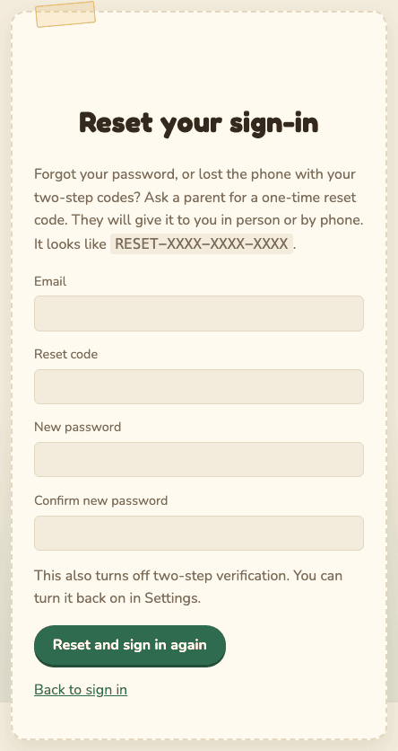
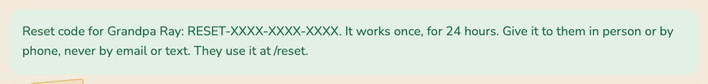

# Account recovery

**Who this is for:** anyone who cannot sign in, and guardians helping a family member get back in.

There is no "forgot password" email link. That is on purpose: whoever controls an email inbox
could otherwise take over the account. Instead, a guardian gives you a one-time **reset code** in
person or by phone.

## I forgot my password

1. Call or talk to a guardian. Ask for a **reset code**.
2. They give you a code like `RESET-XXXX-XXXX-XXXX`. It works once, for 24 hours.
3. On the Sign In page, select **Use a reset code from a parent** (or go to `/reset`).
4. Type your **Email**, the **Reset code**, and a **New password** twice.
5. Select **Reset and sign in again**.
6. You are taken back to the Sign In page with "Your sign-in was reset. Sign in with your new
   password." Sign in.

Using a reset code also:

- turns **off** two-step verification (turn it back on in **Security**),
- signs out every other device,
- emails you and the guardians.

If you see "That reset code cannot be used...", it may be mistyped, used, expired, not active yet,
or for a different email. Ask for a new one.

## I lost my phone

If you use two-step verification and lose the phone with your authenticator app:

1. Sign in with your email and password as usual.
2. When asked for the 6-digit code, type one of your **recovery codes** instead (they look like
   `ABCDE-FGHJK`).
3. Go to **Security** right away. Select **Make new recovery codes**, and print or write down the
   new ones.
4. To move two-step verification to a new phone, you need a reset code from a guardian. (Turning it
   off yourself needs a code from the old phone.) You can keep signing in with recovery codes
   until then, one code per sign-in.
5. If the phone might be in someone else's hands, select **Sign out everywhere** and change your password.

## I lost my phone and my recovery codes

Ask a guardian for a reset code and follow [I forgot my password](#i-forgot-my-password). The reset
also turns off two-step verification, so you can set it up again on your new phone.

## I am locked out after too many tries

After 8 wrong passwords, sign-in pauses for 15 minutes: "Too many failed attempts. Please wait 15
minutes and try again." Wait, then try again carefully. If you still cannot remember it, ask for
a reset code.

If you did not cause the lockout, someone may be guessing your password. Tell a guardian.

## I got an email about a reset I did not ask for

1. Sign in.
2. Open your menu and choose **Security**.
3. Under **Reset codes**, select **Cancel any pending reset code**.
4. Tell the guardians. They are emailed that you cancelled it.

## What a guardian can do for a member

1. Make sure it is really them. Call them. Do not trust an email or a text message.
2. Open **Admin**, find them in **Members**, and select **Reset sign-in**.
3. Confirm. You may be asked to [confirm it is you](getting-started.md#confirm-it-is-you).
4. The code appears **once**, at the top of the page:

   

5. Write it down before you leave the page. It is not shown again. If you lose it, select
   **Reset sign-in** again; the new code replaces the old one.
6. Read it to them by phone or in person. Never send it by email or text.
7. They follow [I forgot my password](#i-forgot-my-password).

The member is emailed that a code was issued, so they will notice one they did not ask for.

Other things a guardian can do:

- **Remove and revoke** a member whose account may be in the wrong hands. It signs them out
  everywhere at once. You can **Restore access** later (with the other guardian's approval).
- Revoke unexpected open codes in **Invite codes**.

## A guardian lost their phone

1. First try a **recovery code** in place of the 6-digit code. Then make new codes in **Security**.
2. No recovery codes? The **other** guardian selects **Reset sign-in** for you.
   - On the family's real site, a guardian's reset code only starts working after **24 hours**.
   - You get an email at once. If you did not ask for it, sign in (if you still can) and cancel it
     under **Security**, then talk to the other guardian.
   - This stops one guardian from quietly taking over the other's account.
3. After the delay, use the code at `/reset`. Then turn two-step verification back on right away
   and save the new recovery codes.

## The only guardian is locked out

If there is only one guardian and they have lost both their phone and their recovery codes, there
is no way back in through the site. Whoever runs the server can issue a reset code there. The
steps are in [the runbook](../RUNBOOK.md#1b-a-guardian-lost-their-phone-two-step-codes). It is
recorded in the audit trail.

Avoid this by having two guardians and keeping printed recovery codes somewhere safe.
