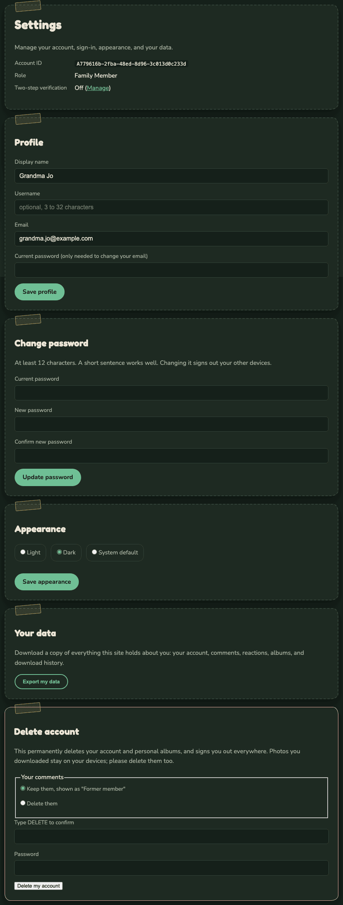
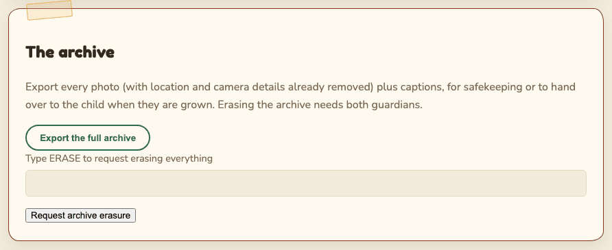

# Data export and erasure

**Who this is for:** family members who want a copy of their data or to leave, and guardians
looking after the child's whole photo archive.

## For family members

Open your menu and choose **Settings**. Scroll to **Your data** and **Delete account**.

### Download your data

Select **Export my data**. You get a zip file containing one file with everything the site holds
about you:

- your account: email, name, username, role, when you joined, whether two-step verification is on,
  and which privacy notice you accepted,
- your comments (including ones that were removed) and reactions,
- your albums and which photos are in them,
- photos you sent in (their captions and dates),
- your download history.

It does not include the photos themselves. Those belong to the family archive.

### Delete your account

1. Under **Your comments**, choose:
   - **Keep them, shown as "Former member"**, or
   - **Delete them**.
2. Type `DELETE` in **Type DELETE to confirm**.
3. Type your **Password**.
4. Select **Delete my account** and confirm.

This happens at once and cannot be undone:

- Your account, your albums and your reactions are deleted.
- You are signed out everywhere.
- Photos you sent in stay in the family library, shown as from "Former member".
- Your download records stay until they expire (90 days), shown as "Former member".
- The guardians get an email that a member deleted their account.

Photos you downloaded stay on your own devices. Please delete them too.

Guardians cannot delete their own account. The other guardian removes it from **Admin**,
**Members**, so the archive always has an owner.

## For guardians: the whole archive

The last section of **Admin** is **The archive**.

### Export the archive

Select **Export the full archive**. You may be asked to [confirm it is you](getting-started.md#confirm-it-is-you).
You get a zip file with:

- every photo, full size, with location and camera details already removed,
- `index.json`, listing each photo's file name, caption, date, who uploaded it, and an id for the
  guardian who shared it.

Comments, reactions and albums are not included. Use it for safekeeping, or to hand the photos to
the child when they are grown.

Either guardian can export alone. The other guardian gets an email ("The photo archive was
exported"). Keep the file somewhere private: it is every photo, with no marks.

### Erase the archive

Erasing deletes **every photo** on the site permanently: every stored copy, and their comments,
reactions and reports. Accounts, groups and the records stay. Download and security records keep
the fact that something happened, without the photo.

1. Type `ERASE` in **Type ERASE to request erasing everything**.
2. Select **Request archive erasure** and confirm.
3. You may be asked to [confirm it is you](getting-started.md#confirm-it-is-you).
4. The request waits for the other guardian. They approve it under **Changes waiting on a
   guardian**. With a single guardian it runs after a 24-hour delay instead. See
   [Two-guardian approval](two-guardian-governance.md).

Before you erase:

- Export the archive first if you want to keep anything.
- Copies family members already downloaded cannot be recalled.
- Backups expire within 30 days. After that the photos are gone for good.
