# Family members

**Who this is for:** relatives and friends the guardians invited. Your account shows the role
**Family member**.

The guardians own every photo and decide who sees it. You can look, collect favorites, talk about
the photos, and send in your own pictures for the guardians to approve.

## Join with an access code

A guardian gives you an **access code**. It looks like `INVITE-XXXX-XXXX-XXXX`. They should give it
to you privately, for example by phone or in person.

- A code works **once**.
- It stops working after **72 hours**.
- It may be tied to your email. Then it only works with that exact email address.

To join:

1. Open the site address the family gave you. On the Sign In page, select **Create an account**
   (or go straight to `/register`).
2. Type the **Access code**.
3. Type **Your name** as you want the family to see it, for example "Grandma Jo".
4. Type your **Email**. If the guardian tied the code to an email, use that one.
5. Choose a **Password** of at least 12 characters, and type it again in **Confirm password**.
6. Read **Before you join**. Open the privacy notice link if you want the full version.
7. Tick **I have read the privacy notice and agree to keep these photos private.**
8. Select **Create Account**.

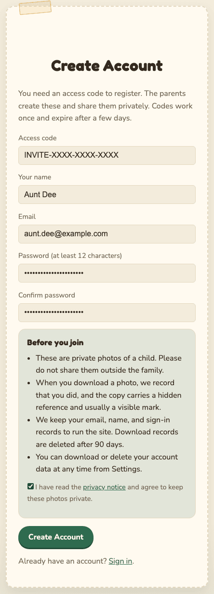

You are signed in straight away and see "Welcome. Your account has been created." The guardians
get an email saying you joined.

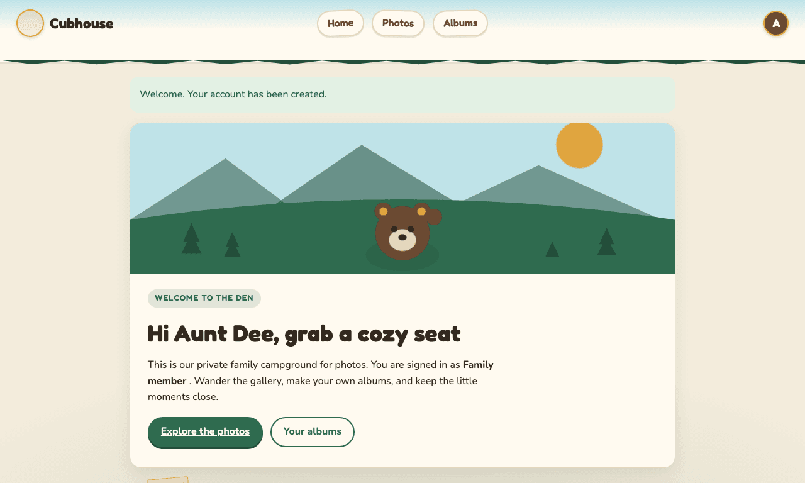

Some names are reserved so nobody can pretend to be a guardian in comments. "Mom", "Dad", "Parent",
"Admin" and similar names are refused with "Please choose a display name that is your own name."

If you see "That access code cannot be used...", the code may be mistyped, used, expired, or tied
to a different email. Ask the guardian for a new one. The site does not say which, on purpose.

## Your home page

**Home** shows a welcome, the newest photos ("Fresh from the trail"), and counts of how many photos
you can see and how many albums you have.

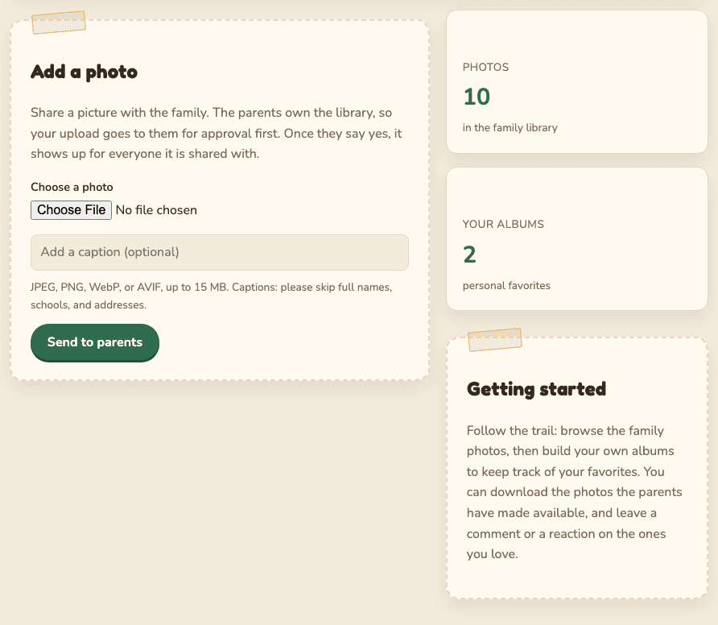

On a phone the page stacks into one column:

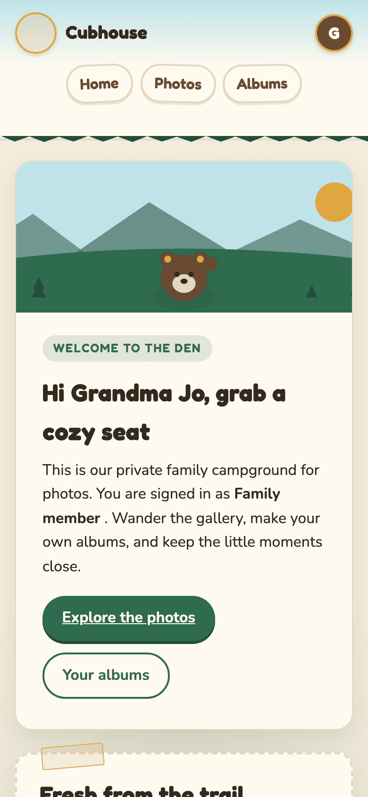

## Browse photos

1. Select **Photos** at the top.
2. Select a picture to see it larger. Select **Open full details** for its own page, or the
   **×** to close.
3. Or select **Open** under a photo to go straight to its page.

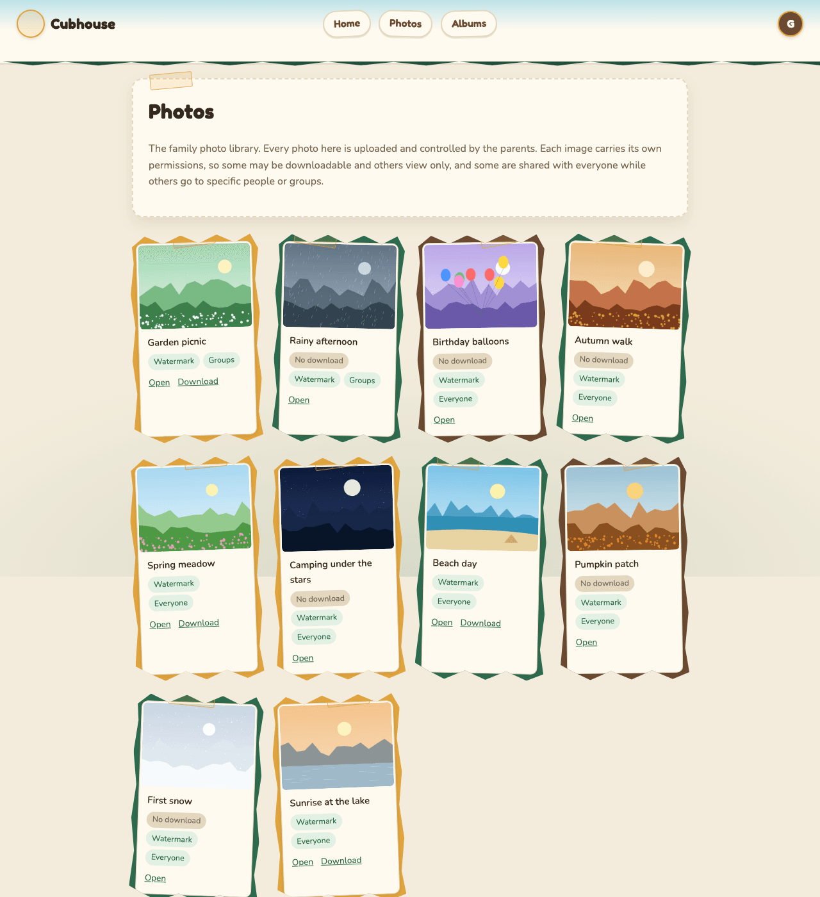

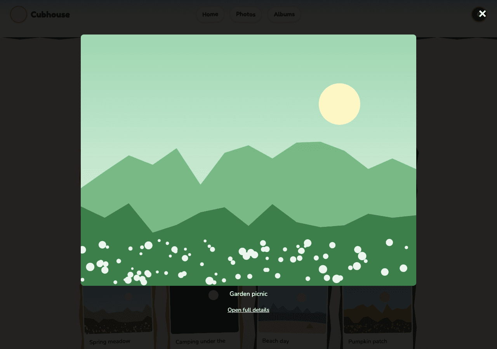

On a phone:

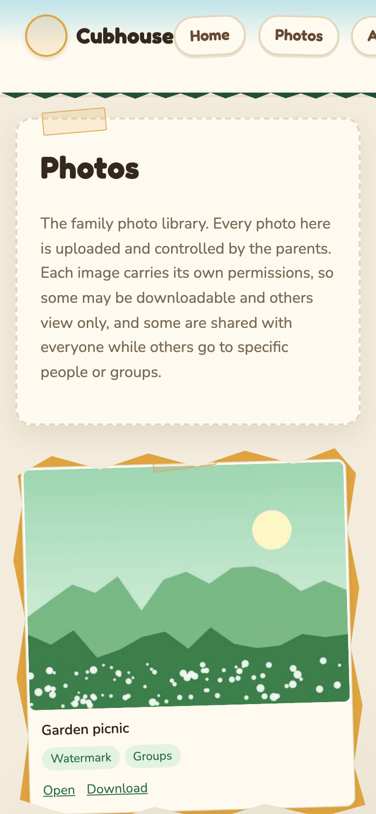

## A photo's page

Each photo has its own page with the picture, a **Download** button (if allowed), **Reactions**,
**Comments**, and **Add to one of your albums**.

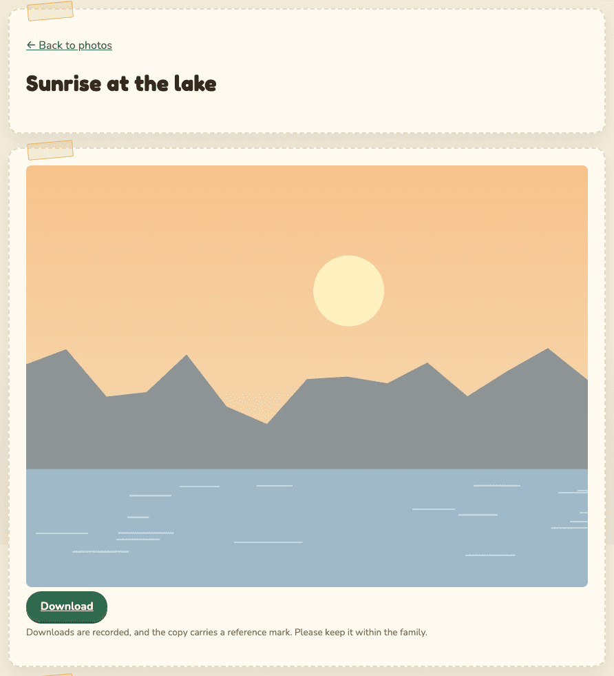

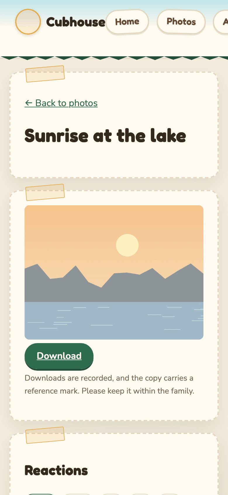

### Reactions

Select an emoji to add your reaction. Select it again to take it back. Your own reactions are
highlighted, and the number shows how many people chose each one.

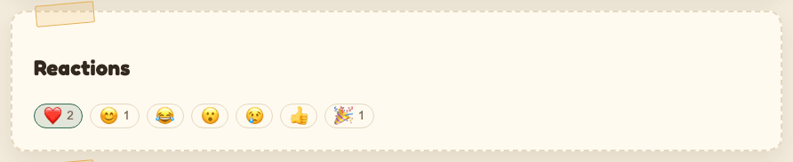

If you see "Reactions are turned off for this photo", the guardians turned them off for that picture.

### Comments

1. Type in **Add a comment**.
2. Select **Post comment**.

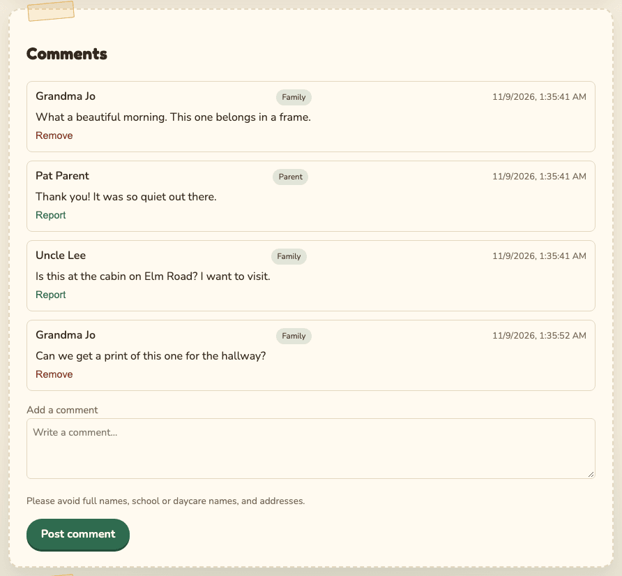

- Each comment shows a badge: **Parent** for guardians, **Family** for everyone else.
- Please leave out full names, school or daycare names, and addresses.
- Comments can be up to 2000 characters.
- To delete your own comment, select **Remove** under it.

### Report a comment

If a comment worries you, for example it mentions where the child lives or goes to school:

1. Select **Report** under the comment.
2. Confirm.

You see "Thanks. The parents will take a look." The guardians get an email and can remove it.

There is no report button for photos themselves. If a photo should not be on the site, tell a
guardian directly.

### Download a photo

You can only download a photo when the guardians allow it. When they do, its page shows a
**Download** button with the note "Downloads are recorded, and the copy carries a reference mark."

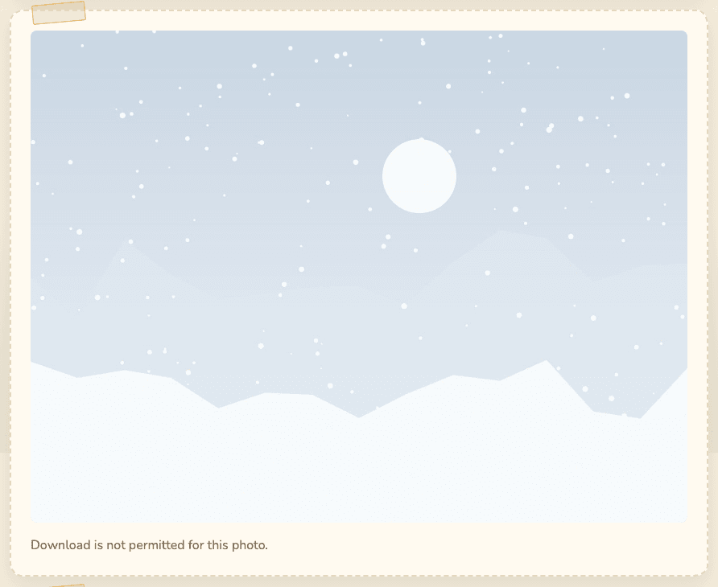

What happens when you download:

- The guardians can see that you downloaded it, and when.
- Your copy carries a hidden reference code. It does not contain your name.
- Usually it also has a visible line at the bottom: "Private family photo. Please do not share.
  Ref ..." and a faint reference across the middle.

Please keep downloaded photos private. Do not post them online or forward them.

## Albums

Albums are your own collections of favorites. Only you see your albums. Making an album never
changes who can see or download a photo.

### Make an album

1. Select **Albums** at the top.
2. Type a name in **New album name**, for example "Summer favorites".
3. Select **Create album**.

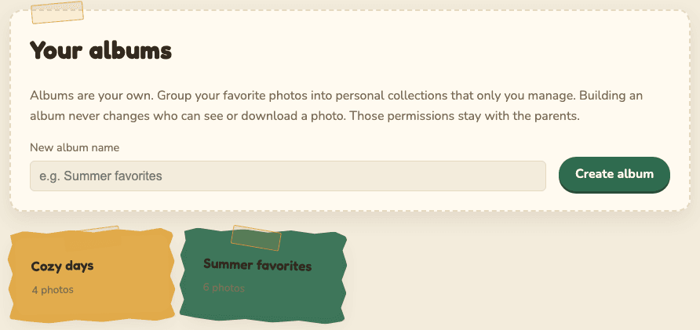

### Add a photo to an album

1. Open the photo's page.
2. In **Add to one of your albums**, choose the **Album**.
3. Select **Add to album**.

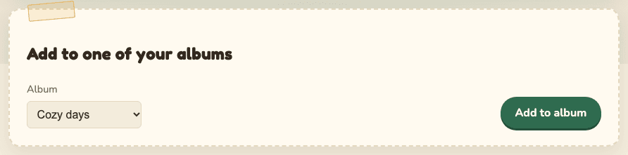

### Look at, tidy or delete an album

Open the album from the **Albums** page. Select **Remove** under a photo to take it out, or
**Delete album** to delete the album. The photos themselves are never deleted.

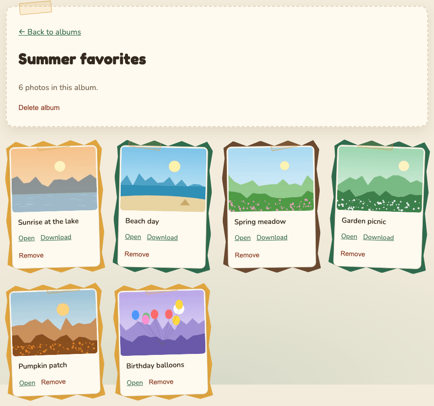

If a guardian stops sharing a photo with you, it disappears from your albums too.

## Send in a photo

You can share your own pictures with the family. The guardians check each one first.

1. Go to **Home**.
2. In **Add a photo**, select **Choose photos**. On a phone this opens your photo library, where you
   can pick several at once. On a computer you can also drag photos onto the box.
3. Add a caption if you like. It goes on every photo you picked. Skip full names, schools and
   addresses.
4. Select **Send to parents**. Keep the page open until it says **Finished**.

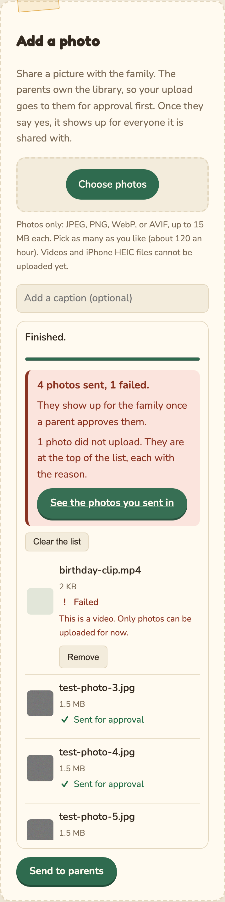

- Each photo shows where it is: **Waiting**, **Uploading** with a percentage, **Saving**, then
  **Sent for approval** or **Failed** with the reason. A failed photo does not stop the others.
- If something fails because of the connection, select **Retry** (or **Retry failed**) once you have
  signal again. **Cancel** stops a photo that has not finished sending.
- At the end, a summary says how many were sent. Select **See the photos you sent in** to check on
  them.
- JPEG, PNG, WebP or AVIF, up to 15 MB each, about 120 an hour. Videos can't be sent yet. iPhone
  photos may need a setting change; see
  [Troubleshooting](troubleshooting.md#my-photo-will-not-upload).
- Location and camera details are removed automatically.
- **Photos you sent in** shows each one as **Pending approval** or **Published**.
- Once you send a photo, it belongs to the family library. Only the guardians can share or delete it.

## Your settings

Open your menu (the round button at the top right) and choose **Settings**.

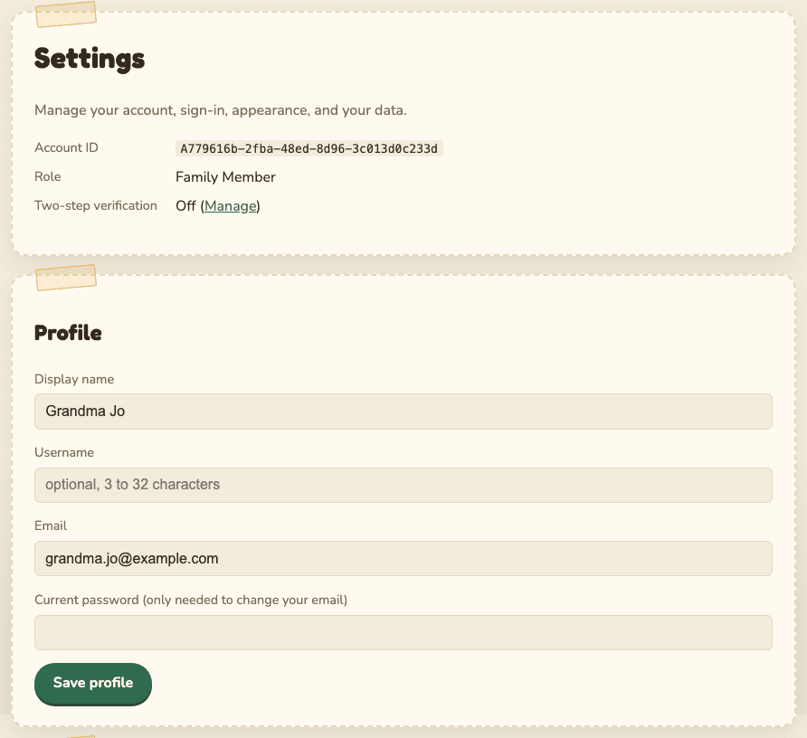

### Profile

- **Display name**: how the family sees you.
- **Username**: optional.
- **Email**: to change it, also type your **Current password**. Your old email gets a message
  about the change, in case it was not you.

Select **Save profile**.

### Password

In **Change password**, type your current password and the new one twice, then select **Update
password**. Your other devices are signed out.

### Appearance

Choose **Light**, **Dark**, or **System default** (follows your phone or computer), then select
**Save appearance**.

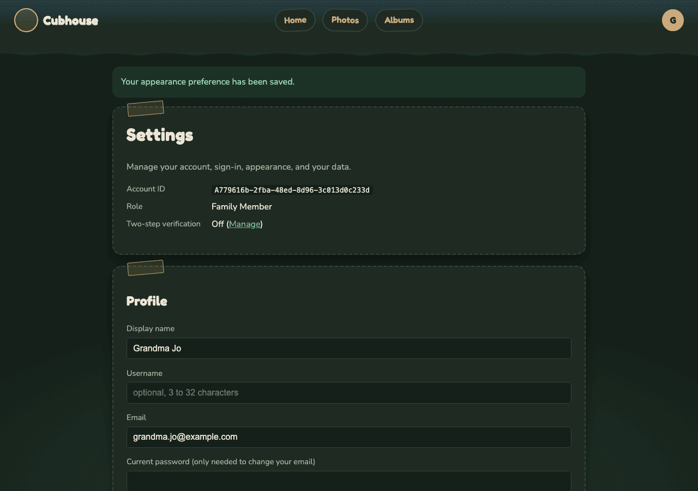

### Your data and deleting your account

See [Data export and erasure](data-export-and-erasure.md#for-family-members).

## What you can and cannot see

You **can** see:

- Photos shared with the whole family.
- Photos shared with you by name, or with a group you are in (for example "Grandparents").
- Comments and reactions on those photos.
- Your own albums.

You **cannot** see:

- Photos the guardians keep private, or have hidden.
- Photos waiting for approval, including other people's.
- Other people's albums.
- Who else is a member, their emails, or any admin pages.
- The full original file of a photo, unless you download it with permission.

If a photo you saw before is gone, a guardian probably changed who can see it. That is their
choice to make; ask them if you are curious.

## Phones

Everything works on a phone. The round menu button stays at the top right, and **Home**,
**Photos** and **Albums** move to their own row below the site name. Tap the round button for
**Settings**, **Security** and **Sign out**.

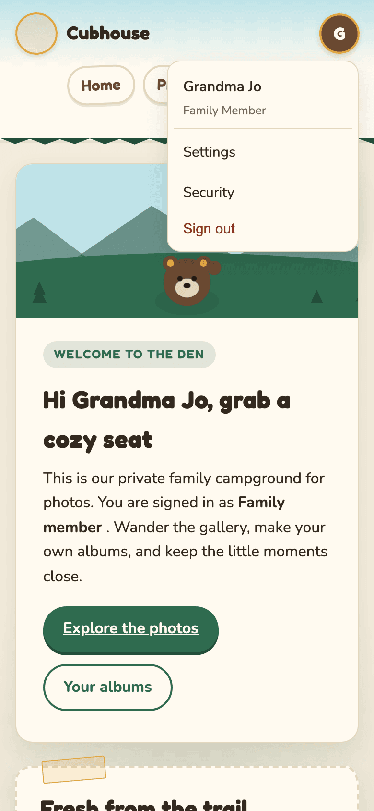

If you cannot reach the menu, see [Troubleshooting](troubleshooting.md#on-my-phone-i-cannot-reach-the-menu).
