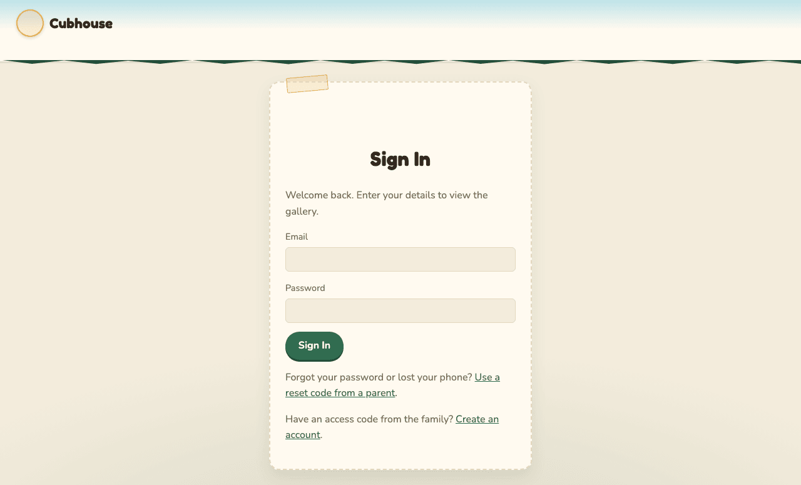
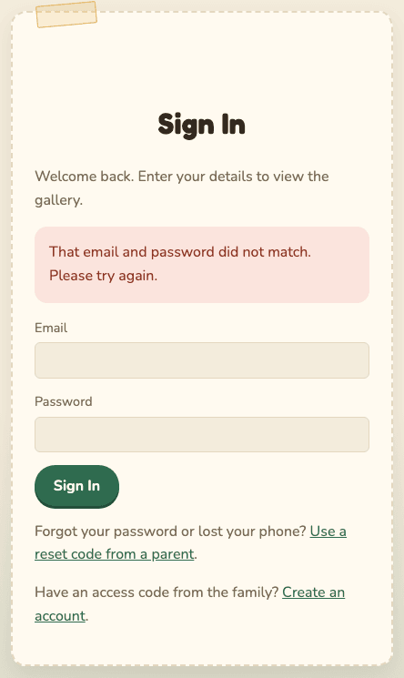
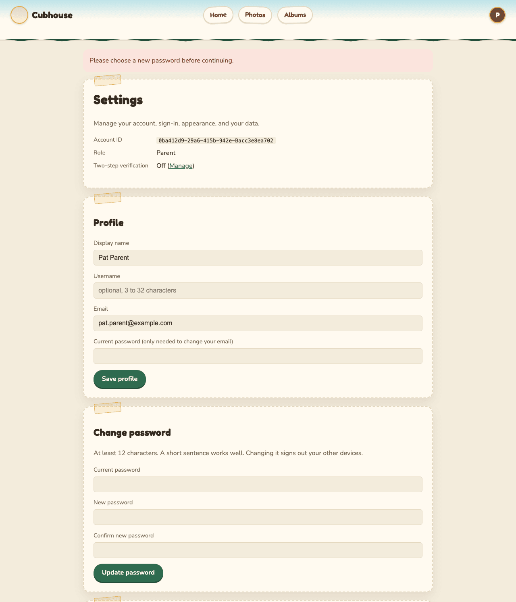
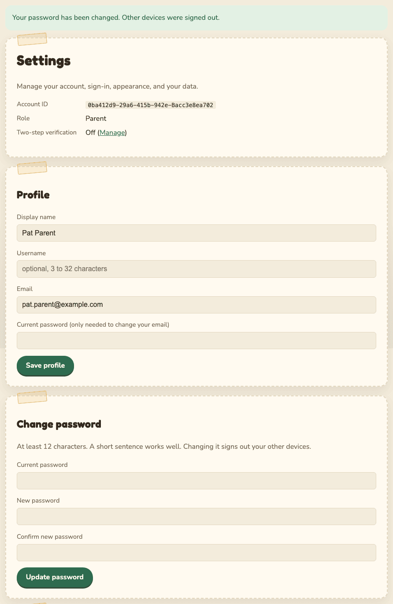
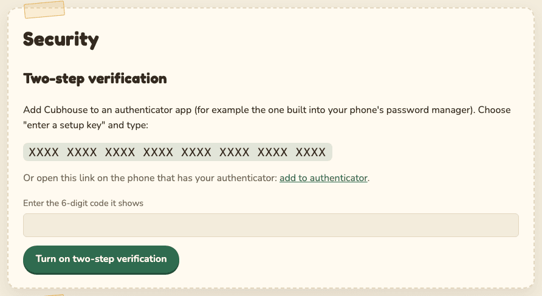
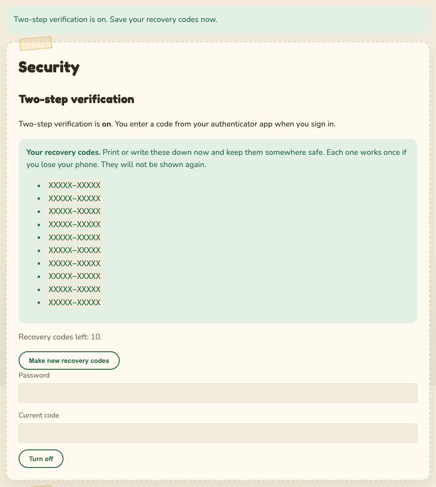
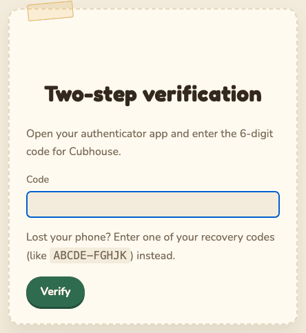
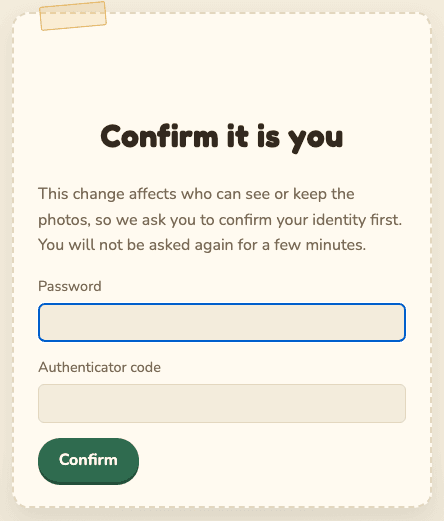
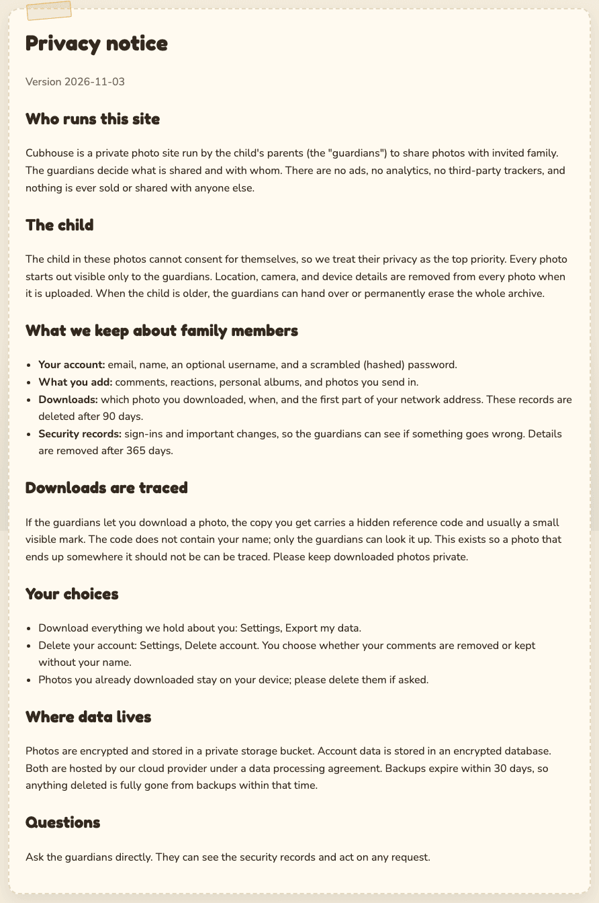

# Getting started

**Who this is for:** anyone signing in to Cubhouse, guardians and family members alike. If you do
not have an account yet, first [join with an access code](family-members.md#join-with-an-access-code).

## Sign in

1. Open the site address the family gave you.
2. Type your **Email** and **Password**.
3. Select **Sign In**.

If the email or password is wrong, you will see: "That email and password did not match. Please
try again." The message is the same whether or not the email has an account, on purpose.

After 8 wrong tries, sign-in pauses for 15 minutes. You and the guardians get an email about it.
See [Troubleshooting](troubleshooting.md#too-many-failed-attempts).

### How long you stay signed in

- If you do nothing for **15 minutes**, you are signed out.
- Even if you keep using the site, you sign in again after **7 days**.
- To sign out yourself, open your menu (the round button at the top right) and choose **Sign out**.

## First sign-in: choose a new password

Some accounts are set up with a temporary password. The first guardian account on a new site
always is. When that happens, the site sends you straight to Settings with the message "Please
choose a new password before continuing." You cannot use the rest of the site until you do.

1. In **Current password**, type the temporary password.
2. In **New password** and **Confirm new password**, type your new password.
3. Select **Update password**.

Password rules:

- At least 12 characters. A short sentence you can remember works well.
- It cannot be the same as your email.
- On the family's real site, passwords that are known to have leaked elsewhere are refused.
  (Only a small, scrambled piece of the password is checked. The password itself never leaves the site.)

When it works you see "Your password has been changed. Other devices were signed out." Any other
phone or computer signed in to your account is signed out at the same time.

## Two-step verification

Two-step verification means you need two things to sign in: your password, and a 6-digit code
from an app on your phone. Someone who learns your password still cannot get in without your phone.

- **Guardians must turn it on.** On the family's real site, a guardian cannot use anything until it is on.
- **Family members can choose.** We recommend it.

You need an authenticator app on your phone. Many phones have one built into the password
manager. Google Authenticator, Microsoft Authenticator and similar apps also work.

### Turn it on

1. Open your menu and choose **Security**.
2. In your authenticator app, add a new account and choose **enter a setup key** (it may say
   "enter code manually").
3. Type the setup key shown on the page. Or, if you are reading this page on the same phone as
   your authenticator, select **add to authenticator**.
4. The app now shows a 6-digit code that changes every 30 seconds. Type it into **Enter the
   6-digit code it shows**.
5. Select **Turn on two-step verification**.

The setup key is a secret. Do not share it, photograph it, or send it to anyone. (It is hidden in
the picture above.)

The site may first ask you to confirm your password. That is normal; see
[Confirm it is you](#confirm-it-is-you).

If you see "That code did not match. Check the time on your phone and try again.", your phone's
clock is probably off. See [Troubleshooting](troubleshooting.md#my-6-digit-code-is-not-accepted).

### Save your recovery codes

As soon as it is on, the page shows **10 recovery codes**. Each one gets you in once if you lose
your phone.

1. Print them, or write them on paper.
2. Keep them somewhere safe at home, away from your phone.
3. Do not save them in email or a photo on your phone.

They are shown **only once**. If you lose them, you can make a new set any time: open
**Security** and select **Make new recovery codes**. The old ones stop working. The page also
tells you how many codes you have left.

### Signing in with two-step verification

After your password, the site asks for a code.

1. Open your authenticator app.
2. Type the 6-digit code for Cubhouse.
3. Select **Verify**.

Lost your phone? Type one of your recovery codes (they look like `ABCDE-FGHJK`) in the same box.
Each code works once. You get an email each time one is used, saying how many are left. Then read
[Account recovery](account-recovery.md#i-lost-my-phone).

### Turning it off

Family members can turn it off on the **Security** page by entering their password and a current
code, then selecting **Turn off**. Guardians cannot turn it off on the family's real site.

## Confirm it is you

Before some important changes, the site asks for your password again (and your 6-digit code if
you use two-step verification). This is called step-up confirmation. It stops someone who finds
your computer unlocked from making big changes.

1. Type your password (and code, if asked).
2. Select **Confirm**.
3. You are taken back to the page you were on, with the message "Thanks. Please submit your
   change again." Make the change again.

You will not be asked again for 5 minutes. Signing in also counts.

## The privacy notice

The privacy notice explains, in plain words, what the site keeps about you and why. You can read
it before you join, from the link on the Create Account page, and any time from the **Privacy
notice** link at the bottom of every page.

When the notice changes, a blue bar appears at the top of each page: "The family privacy notice
has been updated. Please take a moment to read it." Open it and select **I have read this
notice** at the bottom to make the bar go away.

## Next steps

- Family members: [what you can do](family-members.md).
- Guardians: [your controls](guardians.md).
- Worried about a lost password or phone: [Account recovery](account-recovery.md).
