# Guardians

**Who this is for:** the child's parents or guardians. Your account shows the role **Parent**.

You have full control: you upload and share photos, invite and remove people, and approve the
other guardian's protected changes. A few big changes need both guardians to agree; those are
explained in [Two-guardian approval](two-guardian-governance.md).

The golden rule: **restricting is always instant, widening needs the other guardian.** You can
always hide a photo, lock downloads or remove someone on your own, right now.

On the family's real site you must turn on [two-step verification](getting-started.md#two-step-verification)
before you can use anything. Many actions below ask you to [confirm it is you](getting-started.md#confirm-it-is-you) first.

## Your home page

As a guardian, **Home** adds:

- **Waiting for your approval**: photos family members sent in.
- **Add a photo**: upload to the family library.
- **Waiting on a guardian**: a count of protected changes waiting for a decision, with a
  **Review requests** button.
- **Parent controls**: the number of members and access codes, and an **Open the ranger station**
  button that takes you to Admin.

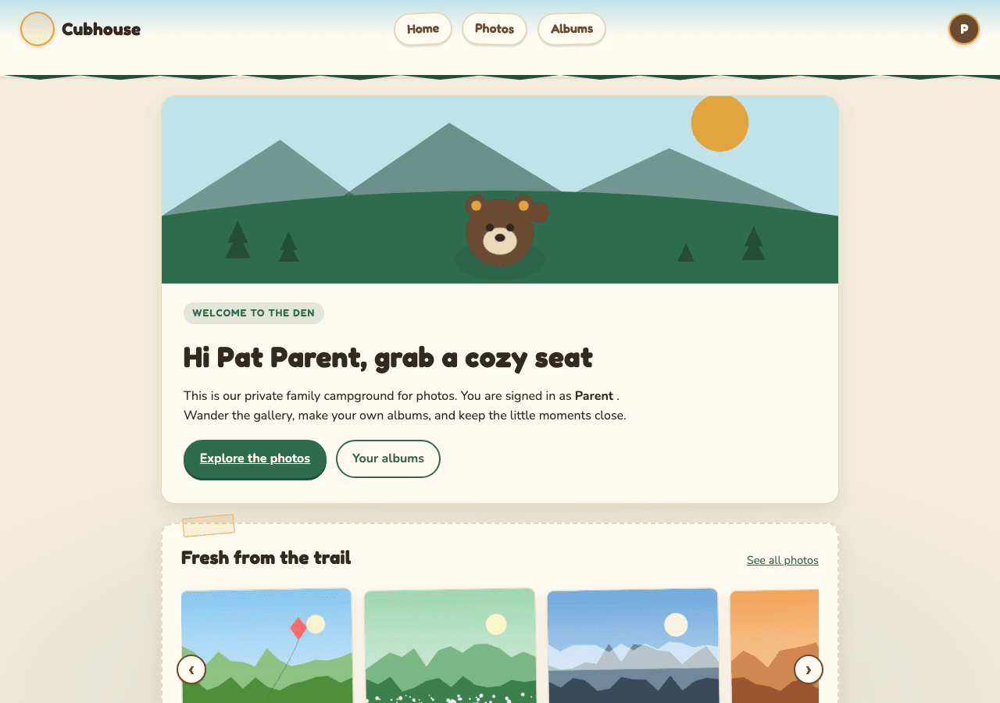

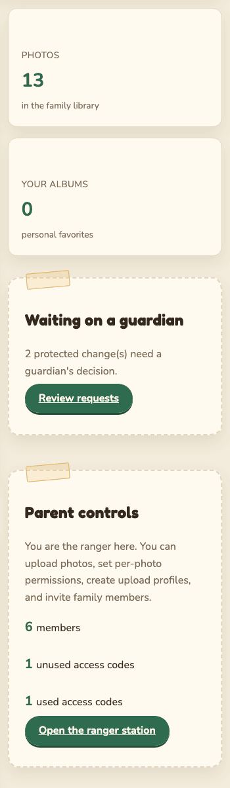

## Upload photos

You can upload one photo or a whole batch at once.

1. Go to **Home**.
2. In **Add a photo**, select **Choose photos** and pick as many as you like. On a computer you can
   also drag photos onto the box. Each photo appears in a list.
3. Add a caption if you like. It goes on every photo in this batch. Skip full names, schools and
   addresses.
4. Optional: in **Share using a profile**, pick an [upload profile](#upload-profiles) to share them
   right away. Leave it on **Keep it private for now** to share later.
5. Select **Upload photos**. Keep the page open until it says **Finished**.

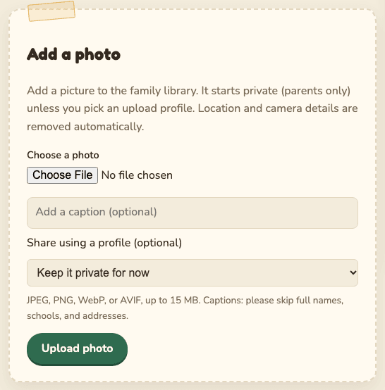

While the batch uploads, each photo shows where it is: **Waiting**, **Uploading** with a percentage,
**Saving** (the site is removing location details), then **Added** or **Failed** with the reason.
Three photos go at a time, and one failure does not stop the others.

- Select **Cancel** on a photo, or **Cancel all**, to stop. Once a photo says **Saving** it can no
  longer be cancelled.
- When the batch ends, a summary says how many were added and how many failed. Failed photos move
  to the top of the list. Select **Retry** on one, or **Retry failed** for all of them.
- Select **View the new photos** to open **Photos**, or **View** on one photo to open it.
- If you try to leave the page mid-upload, your browser asks you to confirm first.
- JPEG, PNG, WebP or AVIF, up to 15 MB each, and about 120 photos an hour. Videos and iPhone HEIC
  files cannot be uploaded yet. Files like these fail straight away, before anything is sent.
- Every photo is rebuilt from its pixels. GPS location, camera model and every other hidden detail
  are removed. The original file is not kept.
- New photos are visible to guardians only until you share them.
- If the profile you picked shares with the whole family or allows downloads, the upload works
  but the sharing waits for the other guardian. Each photo then says **Added, sharing awaits a
  guardian**, and the other guardian gets one request per photo. For a big batch it is quicker to
  upload privately, then share them all at once from **Photos**.

## Approve photos family members send in

Contributions appear on **Home** under **Waiting for your approval**. They stay private until you act.

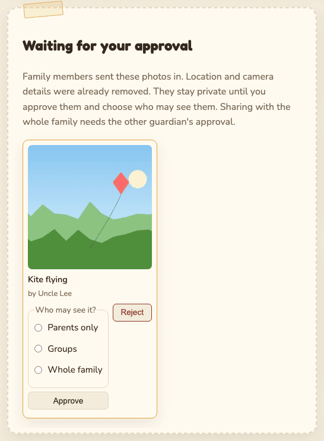

1. Select the picture to look at it closely if you need to.
2. Under **Who may see it?** choose **Parents only**, **Groups** (then tick the groups), or
   **Whole family**. You must choose; there is no default.
3. Select **Approve**.

Or select **Reject** to delete it permanently.

Choosing **Whole family** needs the other guardian's approval. To share with specific people,
approve it as **Parents only** first, then change its sharing on the photo's page.

## Manage photos

Open **Photos**. As a guardian you see every photo, with badges for its settings: **Pending
approval**, **Hidden**, **No download**, **Watermark**, **Comments off**, **Reactions off**, and who
can see it (**Parents only**, **Everyone**, **Groups**, **Specific people**).

### Quick actions on one photo

Under each photo:

- **Hide** / **Unhide**: hiding is instant. Unhiding may need the other guardian.
- **Lock download** / **Allow download**: locking is instant. Allowing needs the other guardian.

### Change many photos at once

1. Select photos by clicking the frame around a photo (not the picture itself), or tick the box in
   its corner. Hold **Ctrl** (or **Cmd** on a Mac) to add one at a time, or **Shift** to select a range.
2. The toolbar shows how many are selected.
3. Choose **Hide**, **Unhide**, **Lock download**, **Allow download**, **Watermark on**,
   **Watermark off** or **Delete**. Or pick an upload profile and select **Move to profile**.

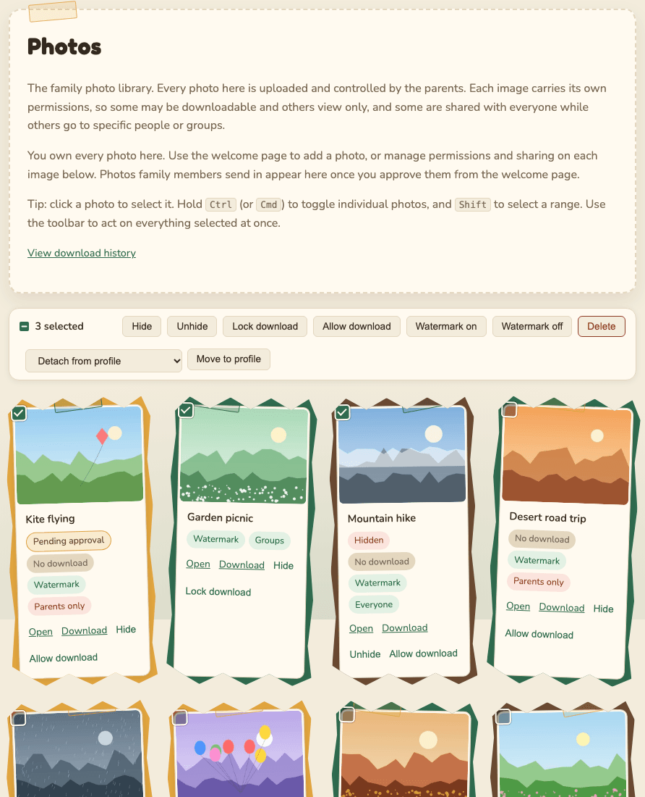

Bulk **Delete** always needs the other guardian. Bulk changes that widen sharing need them too.

### One photo's settings

Open a photo's page and scroll to **Parent controls**.

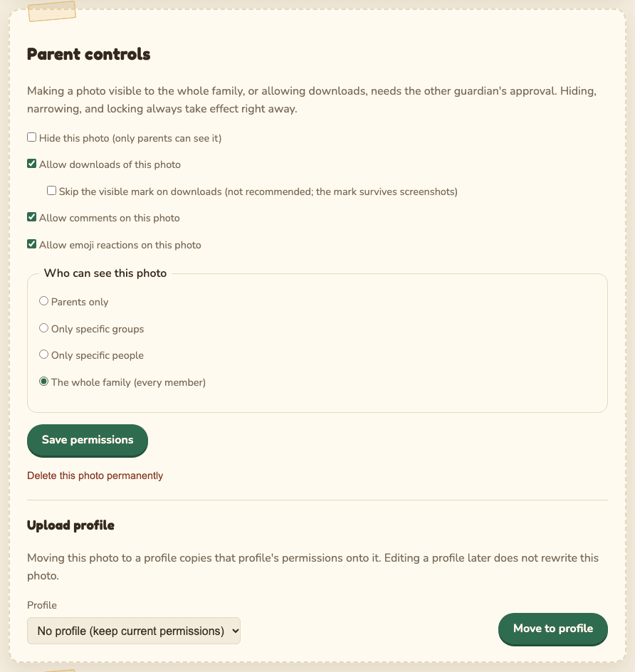

1. Tick or untick:
   - **Hide this photo (only parents can see it)**
   - **Allow downloads of this photo**. When on, you can also tick **Skip the visible mark on
     downloads** (not recommended: the mark is the only thing that survives a screenshot).
   - **Allow comments on this photo**
   - **Allow emoji reactions on this photo**
2. Under **Who can see this photo**, choose **Parents only**, **Only specific groups**, **Only
   specific people**, or **The whole family (every member)**, and tick the groups or people.
3. Select **Save permissions**.

If the change widens who can see or download it, you see "This widens who can see or download
photos, so it is waiting for guardian approval." Sharing with more than half of the family by
name, or with groups that cover more than half, counts as widening too.

Further down:

- **Delete this photo permanently**: removes every copy the site holds, its comments and
  reactions. You confirm first. The other guardian gets an email. Copies family members already
  downloaded cannot be recalled.
- **Upload profile**: **Move to profile** copies a profile's settings onto this photo. Changing
  the profile later does not change the photo.
- **Download history for this photo**: who downloaded it and when.

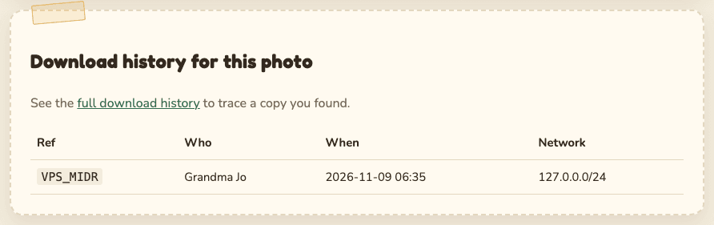

### Comments as a guardian

You can remove any comment. Removed comments disappear for family members, but you still see them,
marked **Removed (visible to parents only)**, so there is a record.

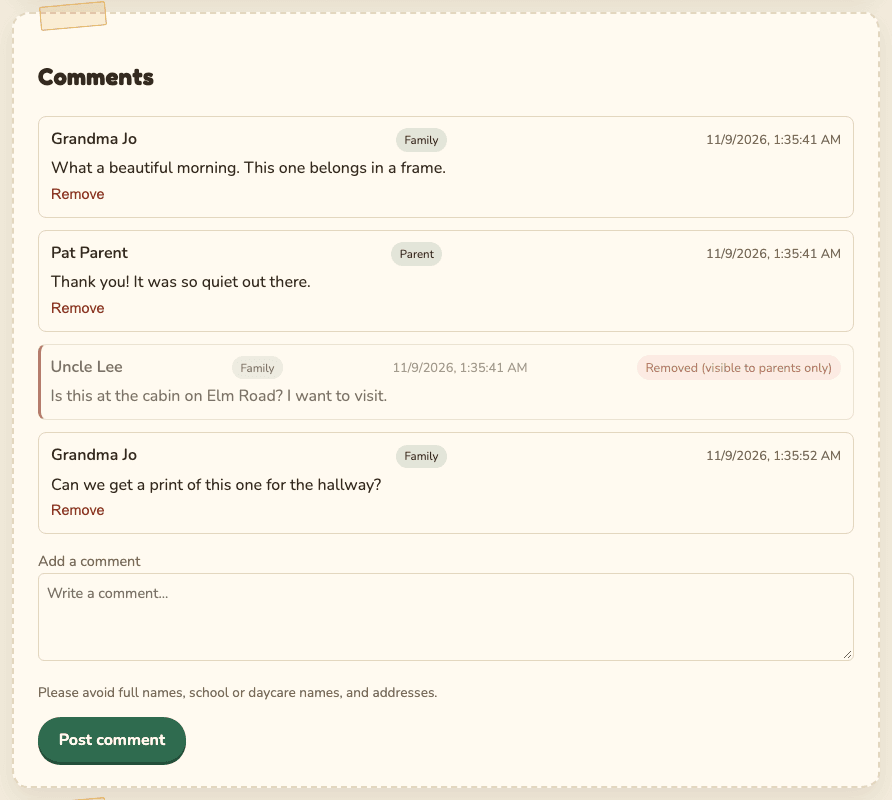

## The Admin page

Open your menu and choose **Admin**. It has everything for people, sharing and records, top to bottom.

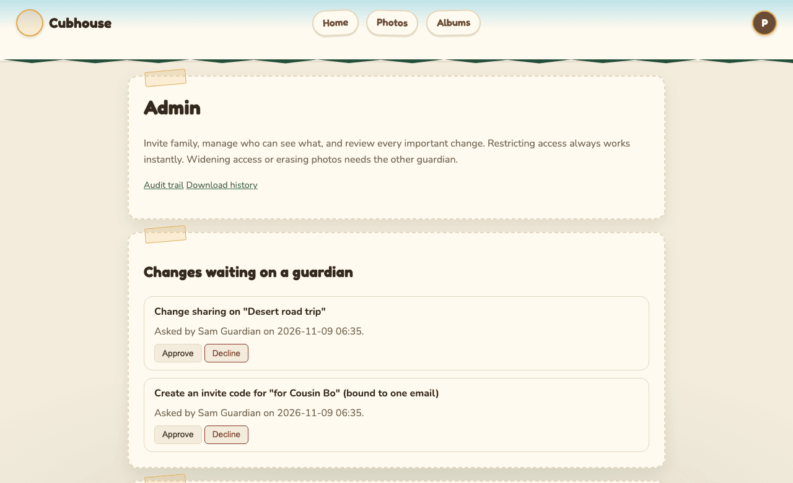

### Family settings: time zone for emails

An email can't know where its reader is, so times written in emails (when an invite code expires,
when a change waiting on the safety delay takes effect, when a guardian's reset code starts
working) use one family time zone, always with the zone named, for example "Fri, Nov 13, 2026,
4:46 PM EST".

1. On the Admin page, find **Family settings**.
2. In **Time zone for emails**, type to search the list, for example `Chicago` or
   `Europe/London`, and pick your zone. Or select **Use my current time zone** to take the one your
   browser is in.
3. Check the example line, **Invite codes will say: ...**, then select **Save time zone**.

**In effect** shows the zone emails use now and where it comes from: set here, the server default
(`APP_TIME_ZONE`), or UTC when neither is set. To go back to the server default, select **Clear and
use the server default**.

Any one guardian can change it at once; it does not need the other guardian, because it changes
how times are written, not who can see anything. Each change is in the audit trail as
**settings.time_zone**, with the old and new zone.

### Changes waiting on a guardian

Protected changes asked for by either guardian. See [Two-guardian approval](two-guardian-governance.md).
Each shows when it was asked for and, with one guardian, when it takes effect, in the family time
zone.

### Invite a family member (access codes)

1. In **Their email (recommended)**, type the person's email. The code then only works for them,
   so a forwarded code is useless.
2. In **Note**, write who it is for, for example "for Grandma".
3. Optional: in **Add them to a group**, choose a group they join automatically.
4. Select **Request invite code**.

Creating a code needs the other guardian. Once approved, the code appears in **Invite codes**.
Give it to the person by phone or in person. It works once and expires after 72 hours.

#### Send the invite by email

To have the site email the code for you, fill in **Their email**, then under **Email it to them**
tick **Email the code to the address above**. You can add their first name for the greeting.

The email goes out once the code is created: after the other guardian approves, or with one
guardian, after the 24-hour safety delay. If the request is declined, cancelled or expires, nothing
is sent. The other guardian sees **Invite code for** the address in their approval list. An emailed
code is always bound to that address.

The email says who invited them, shows the code in a large box, and has a **Join** button that opens
the sign-up page with the code filled in. It also says when the code expires. It never includes
photos or family details. It loads nothing from the internet, so nobody can tell when it is opened.

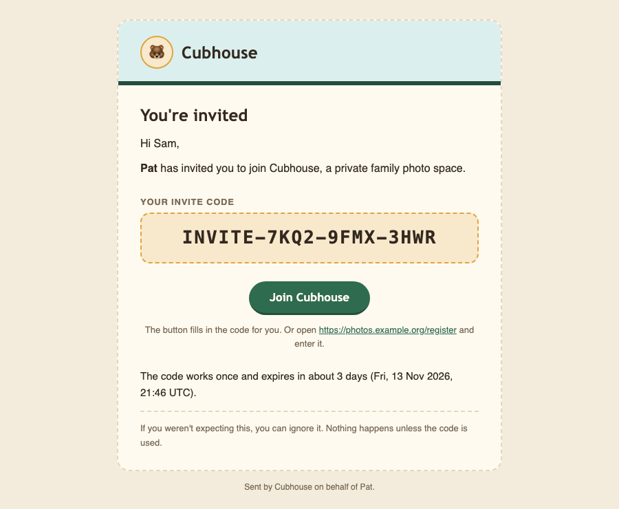

To email an open code you already have, select **Send by email** next to it in **Invite codes**. A
code bound to an email only goes to that address. Each guardian can send up to 10 invite emails an
hour. Every send is in the audit trail as **invite.emailed**, with the address partly hidden.

If email is not set up on the server, the form says so. The code is still created and shown to you,
so share it yourself.

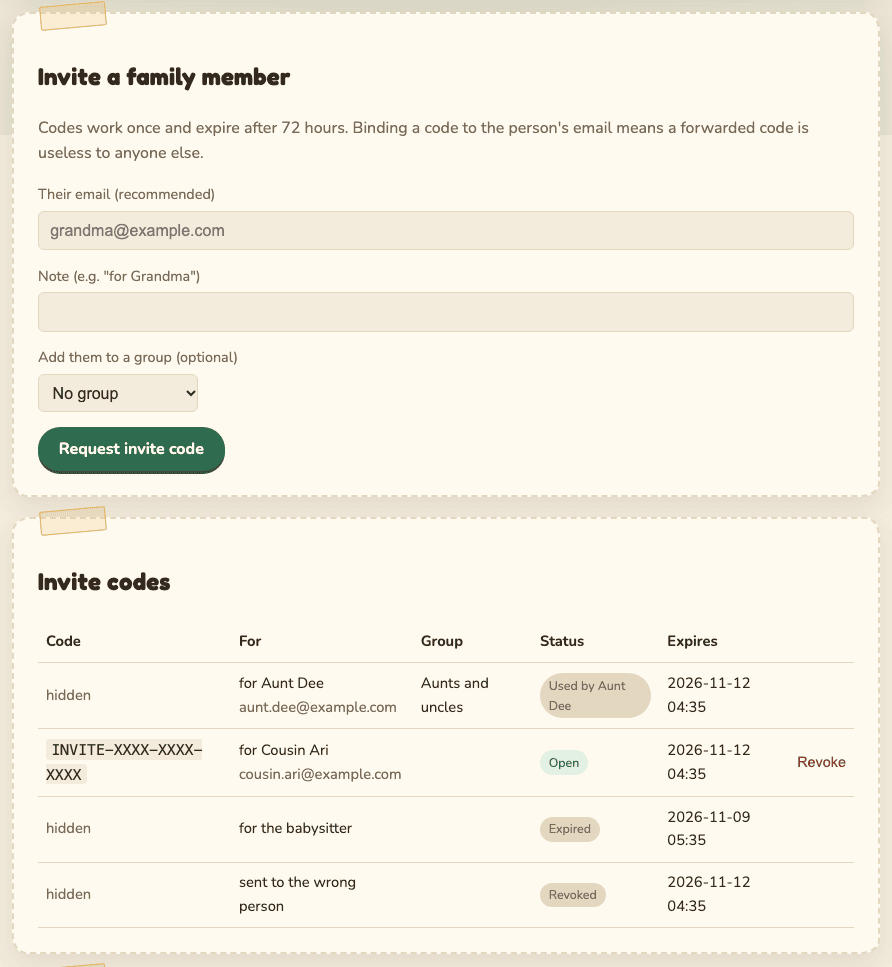

The **Invite codes** table shows each code's note, email, group, status (**Open**, **Used by**
someone, **Expired**, **Revoked**) and expiry. Only open codes are shown in full.

To cancel an open code, select **Revoke**. That is instant. You get an email when someone joins
with a code.

### Members

The **Members** table lists every account with email, role, groups and status badges: **Removed**,
**Muted**, **2-step on**.

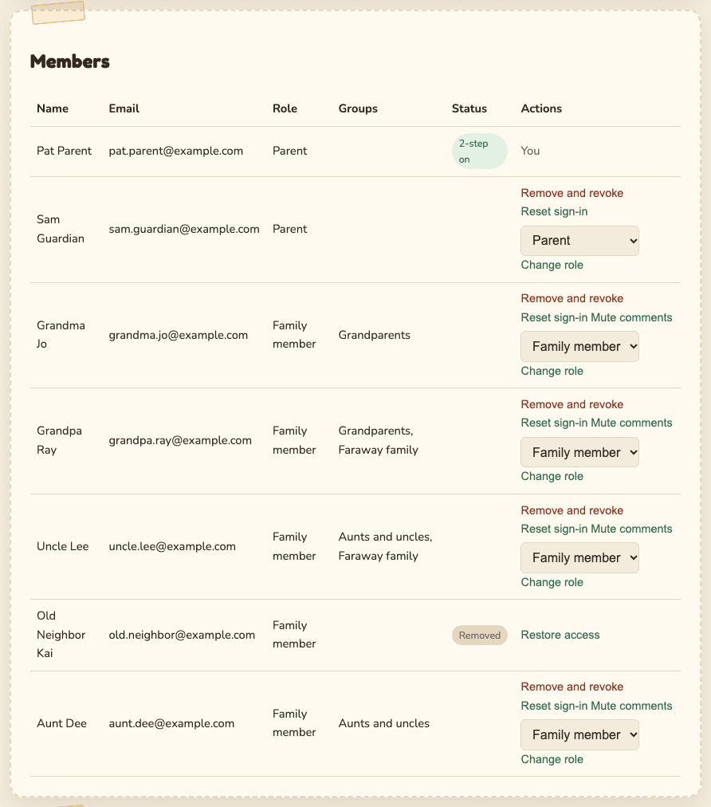

Actions next to each person:

| Action | What it does | Needs the other guardian? |
| --- | --- | --- |
| **Remove and revoke** | Signs them out everywhere at once, blocks the account, takes them out of all groups, and cancels invite codes they made. Their history stays for the records. | Only when removing a guardian. The last guardian cannot be removed. |
| **Reset sign-in** | Gives you a one-time code so they can set a new password. See [Account recovery](account-recovery.md#what-a-guardian-can-do-for-a-member). | No |
| **Mute comments** / **Unmute** | Stops them commenting and reacting. Family members only. | No |
| **Change role** | Switch between **Family member** and **Parent**. They are signed out and sign in again with the new role. | Yes |
| **Restore access** | Shown for removed accounts. Lets them back in. Group memberships must be added again. | Yes |

You confirm before **Remove and revoke** and **Reset sign-in**. The other guardian gets an email
when you remove someone.

### Groups and audiences

Groups let you share with several people at once, for example "Grandparents".

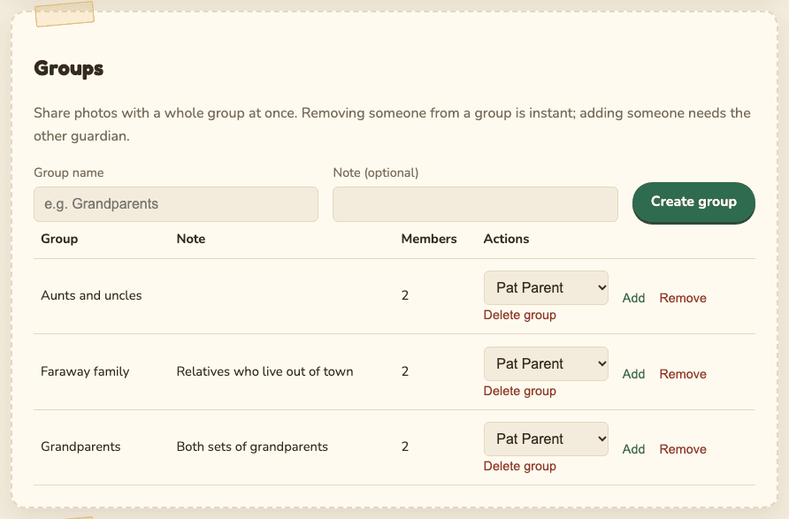

- **Create a group**: type a **Group name** (and a note if you like), then select **Create group**.
- **Add someone**: in the group's row, choose the person and select **Add**. This needs the other
  guardian, because it widens what they can see.
- **Take someone out**: choose the person and select **Remove**. Instant.
- **Delete group**: instant. Photos shared only with that group become guardian-only.

Every photo has one **audience**:

| Audience | Who sees it (besides guardians) |
| --- | --- |
| Parents only | Nobody else. The default for new photos. |
| Only specific groups | Members of the ticked groups. |
| Only specific people | The ticked people. |
| The whole family | Every member. |

### Upload profiles

An upload profile is a saved set of photo settings, for example "Grandparents, downloadable".
Use it when uploading, from a photo's page, or on many photos at once.

1. Open **Create an upload profile**.
2. Give it a **Profile name**.
3. Tick **Allow downloads** (and optionally **Skip the visible mark**), **Allow comments**,
   **Allow reactions**.
4. Choose the **Audience**: **Parents only**, **Specific groups**, **Specific people** or
   **Whole family**, and tick who.
5. Select **Create profile**.

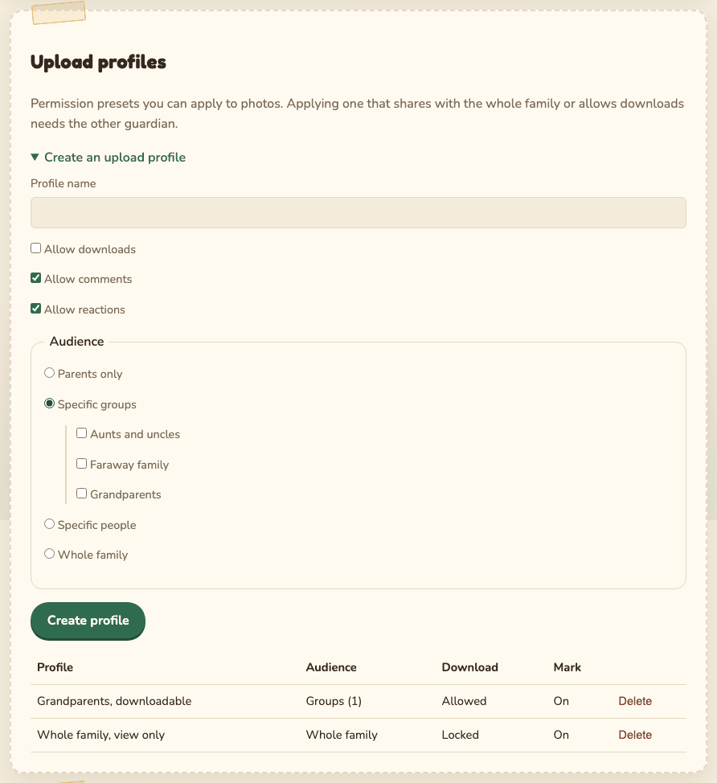

Creating, changing or deleting a profile never changes existing photos. Applying a profile that
widens sharing needs the other guardian. Select **Delete** in the table to remove a profile.

### Reported comments

When a family member reports a comment, you get an email and it appears under **Reported comments**.

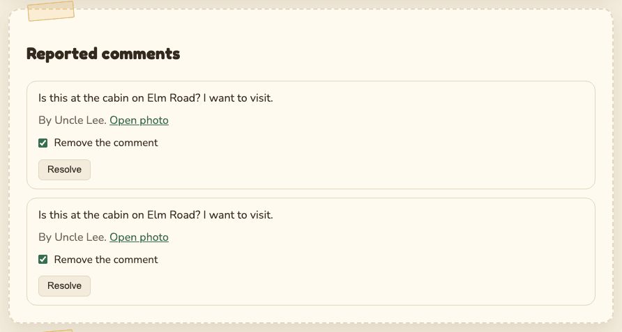

1. Select **Open photo** to see it in context.
2. Leave **Remove the comment** ticked to remove it, or untick to keep it.
3. Select **Resolve**.

If someone keeps posting unkind or unsafe comments, use **Mute comments** in **Members**.

### The archive

The last section on Admin lets you export every photo, or ask to erase them all. See
[Data export and erasure](data-export-and-erasure.md#for-guardians-the-whole-archive).

## Download history and tracing a leaked copy

Open **Admin** and select **Download history** (or **View download history** on Photos).

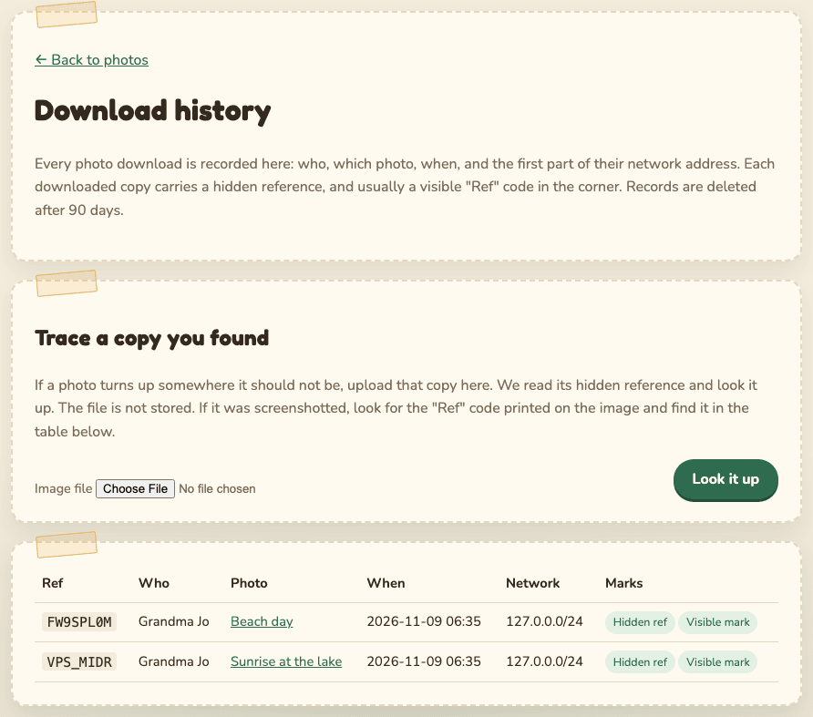

Each row shows the **Ref** code, who downloaded, which photo, when, the first part of their network
address, and whether the copy has a hidden reference and a visible mark. Rows are deleted after 90 days.

If a photo turns up somewhere it should not be:

1. Save the file exactly as you found it. Do not screenshot it yourself.
2. Under **Trace a copy you found**, choose the file and select **Look it up**.
3. The page tells you who downloaded that copy and when. The file is not stored.
4. If it was screenshotted, look for the "Ref" code printed on the image and find it in the table.

Then remove that person (**Admin**, **Members**, **Remove and revoke**) and ask the website to take
the copy down.

## The audit trail

Open **Admin** and select **Audit trail**. It lists every sign-in and every important change:
who, what and when. Nobody can edit or delete it, not even a guardian.

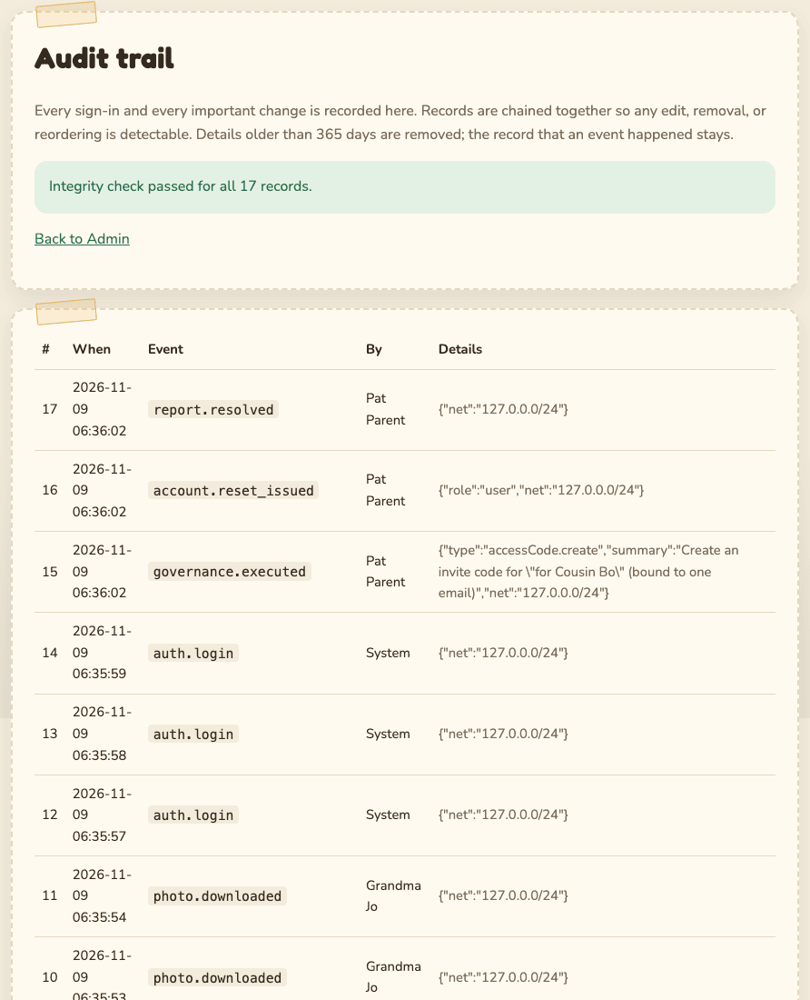

- The green bar "Integrity check passed" means no record was changed or removed. A red bar means
  someone may have tampered with it. Tell the other guardian and whoever runs the server.
- Event names are short codes, like `auth.login` (a sign-in), `member.removed` or
  `governance.executed` (an approved change ran).
- Sign-ins show **System** in the **By** column. The person is in the event itself.
- After 365 days the details are removed, but the record that something happened stays.

## Emails you get

The site emails guardians when, among other things: someone joins with a code, a photo is sent
in, a comment is reported, an account is locked after wrong passwords, a guardian signs in from a
new device, the other guardian deletes a photo, removes someone or exports the archive, and when a
change needs your approval. There is also a daily summary of downloads. Email subjects start with
the site name in brackets, like `[Cubhouse]`. If they land in spam, see
[Troubleshooting](troubleshooting.md#email-alerts-go-to-spam).
