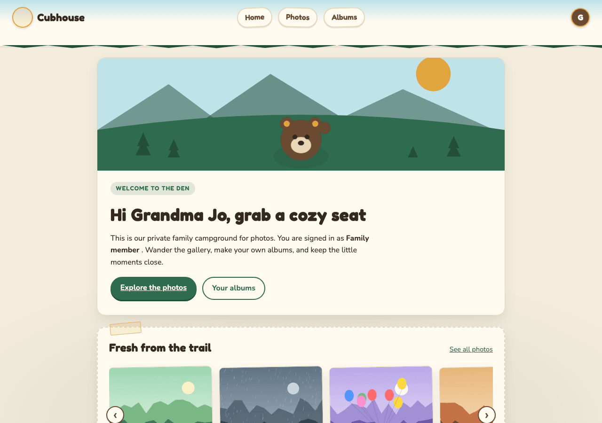
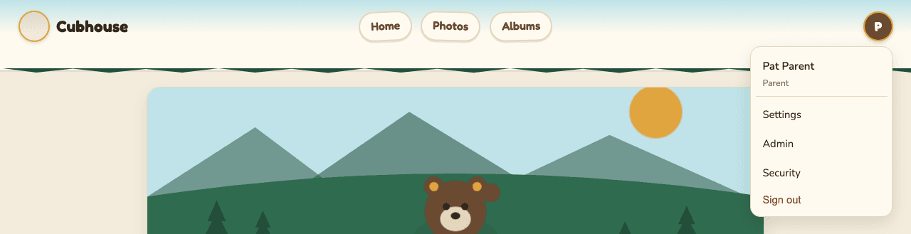

# Cubhouse user guide

**Who this is for:** everyone who uses Cubhouse. Start here, then jump to the page you need.

Cubhouse is a private photo site for one family. A child's parents (the **guardians**) put photos
on it and choose which relatives can see each one. Nobody outside the family can see anything.
There are no ads, no tracking, and no social network in the middle.

Your family may have given the site its own name. This guide calls it Cubhouse. Every screen,
button and step is the same.

All the screenshots in this guide come from a test copy of the site with made-up people
(Pat Parent, Sam Guardian, Grandma Jo, Uncle Lee and friends) and drawn pictures, not real photos.

## The roles at a glance

Every account has one role. You can see yours on the Settings page, next to **Role**.

| Role | Shown in the app as | What it can do |
| --- | --- | --- |
| Guardian | **Parent** | Everything. Uploads and shares photos, invites people, removes people, approves changes, sees the records. Most families have two. |
| Family member | **Family member** | Sees the photos shared with them. Makes personal albums, comments, reacts, downloads photos the guardians allow, and sends in photos for approval. |
| Developer | **Developer** | Only exists on test copies of the site, never on your family's real site. It can look at a read-only admin page but has no extra rights over photos. |

The app labels guardians as "Parent". This guide says "guardian", because that is the word the
emails and safety messages use. They mean the same thing.

## Which page do I need?

| I want to... | Go to |
| --- | --- |
| Sign in for the first time, set a password, or turn on two-step verification | [Getting started](getting-started.md) |
| Join with an access code from the family | [Family members: joining](family-members.md#join-with-an-access-code) |
| Look at photos, make albums, comment, react or download | [Family members](family-members.md) |
| Change my name, email, password or the look of the site | [Family members: settings](family-members.md#your-settings) |
| Invite someone, remove someone, share or hide photos | [Guardians](guardians.md) |
| Understand why a change says "waiting for approval" | [Two-guardian approval](two-guardian-governance.md) |
| Know how my photos and my information are protected | [Security and privacy](security-and-privacy.md) |
| Get back in after forgetting my password or losing my phone | [Account recovery](account-recovery.md) |
| Download my data, delete my account, or export or erase the whole archive | [Data export and erasure](data-export-and-erasure.md) |
| Find a quick answer | [Frequently asked questions](faq.md) |
| Fix something that is not working | [Troubleshooting](troubleshooting.md) |

## Finding your way around

At the top of every page you will see:

- **Home**: your welcome page, with the newest photos.
- **Photos**: every photo shared with you.
- **Albums**: your own personal albums.
- **The round button with your initial** (top right): opens your menu with **Settings**,
  **Security**, **Sign out**, and for guardians **Admin**.

Every page also has a **Privacy notice** link at the bottom.
