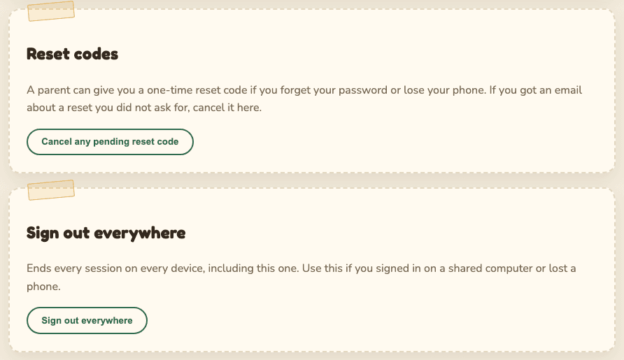

# Security and privacy

**Who this is for:** anyone who wants to know how Cubhouse keeps the photos and their own
information safe, in plain words. The technical version is in
[the security and privacy plan](../SECURITY_PRIVACY_PLAN.md) and the
[privacy risk note](../PRIVACY_RISK_NOTE.md).

## The promise

Parents share photos of their child with the family they invite, and nobody else sees them.

The child cannot agree to having photos online, so the child's privacy comes first. Every choice
below starts from that.

## Who we protect against

The people most likely to misuse a child's photos are usually people who were invited, not
strangers. So the site is built for these cases:

| Worry | What protects against it |
| --- | --- |
| A relative falls out with the family and keeps watching, or tries to find where the child lives | A guardian removes them in one click, and they are signed out at once. Photos never carry location details. |
| One guardian acts against the other | Big changes need both guardians. See [Two-guardian approval](two-guardian-governance.md). |
| Someone posts a photo online | Downloads are off unless a guardian allows them. Every download is recorded and marked so a copy can be traced. |
| Someone steals a password | Two-step verification, sign-in pauses after wrong tries, alerts for new devices. |
| An invite code gets forwarded | Codes work once, expire in 72 hours, and can be tied to one email. |
| Someone gets a copy of the storage or database | The photos are encrypted, and the key is kept somewhere else. |

## Photos

**Hidden details are removed.** Phones hide extra information inside photos, like the GPS spot
where it was taken and the phone's serial number. Cubhouse rebuilds every photo from its pixels
when it is uploaded, so all of that is gone. The original file is never stored.

**Private by default.** A new photo is visible to guardians only. A guardian must choose who else
sees it.

**Encrypted and locked away.** Photos are stored encrypted in a private storage space. Nothing
there can be opened by a web link. Every time your screen shows a photo, the site first checks you
are allowed to see it. Members only ever get a screen-sized version; the full-size file only
comes through a permitted download.

**Downloads are traced.** When a guardian allows downloads, each downloaded copy carries a hidden
reference code and usually a visible mark ("Private family photo. Please do not share. Ref ...").
The code does not contain your name. Only guardians can look it up. This is there so a leaked copy
can be traced back, and so everyone knows it can be.

## Your account

**Passwords.** At least 12 characters. Stored scrambled (hashed), so nobody can read it, not even
the guardians. On the family's real site, passwords known from other leaks are refused, using a
check that never sends your password anywhere.

**Two-step verification.** A code from your phone as well as your password. Required for
guardians, optional for family members. See [Getting started](getting-started.md#two-step-verification).

**Wrong passwords.** After 8 wrong tries, sign-in for that account pauses for 15 minutes, and the
account owner and guardians get an email. A much larger limit also applies across all networks.

**Sign-in alerts.** If your account signs in from a new device or network, you get an email. If it
was not you, change your password and use **Sign out everywhere**.

**Changing your email** needs your current password, and your old address is told.

## Sessions and "sign out everywhere"

A session is the time you stay signed in on one device.

- It ends after 15 minutes of doing nothing, and after 7 days in any case.
- Changing your password signs out every other device.
- **Sign out everywhere** (menu, **Security**) ends every session on every device, including the
  one you are using. Use it if you signed in on a shared computer or lost a phone.
- When a guardian removes someone, or changes their role, it takes effect on that person's very
  next click.

## Confirm it is you (step-up)

Before changes that affect who can see or keep the photos, the site asks a guardian for their
password (and code) again, unless they confirmed in the last 5 minutes. See
[Confirm it is you](getting-started.md#confirm-it-is-you).

## Limits on repeated tries

To slow down anyone guessing, the site limits how often some things can be tried from one place:
signing in, using access and reset codes, creating accounts, posting comments and reactions, and
uploading. Normal use never hits these limits. If you do, wait a little and try again.

## What is kept, and for how long

| What | Kept for |
| --- | --- |
| Your account (email, name, optional username, scrambled password) | Until your account is deleted |
| Your comments, reactions and albums | Until you or a guardian delete them, or your account is deleted |
| Download records (who, which photo, when, the first part of the network address) | 90 days, then deleted |
| Security records (sign-ins and important changes) | Details removed after 365 days. The record that something happened stays, so tampering can be spotted. |
| Backups | Expire within 30 days, so deleted things are fully gone within that time |

Not collected at all: ads, analytics, trackers, full network addresses in the download records,
your browser details, or photo location.

## Who can see your information

- **Guardians** can see your name, email, groups, sign-in records and download records.
- **Other family members** see only your display name, on your comments.
- **Nobody outside the family.** There are no third parties, nothing is sold, and nothing is
  shared.

Questions? Ask the guardians directly. You can always [download your data or delete your
account](data-export-and-erasure.md#for-family-members).
