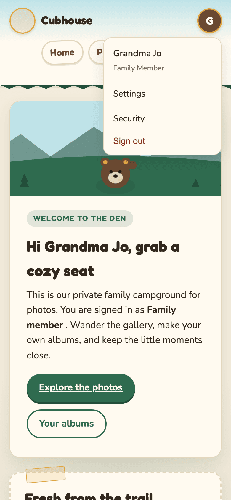

# Troubleshooting

**Who this is for:** anyone who hit a problem. Find the message or symptom below.

## Email alerts go to spam

Cubhouse sends emails about sign-ins, resets, approvals and reports. Their subjects start with the
site name in brackets, for example `[Cubhouse] A change needs your approval`.

If they land in spam or junk:

1. Open your spam or junk folder and find one of the emails.
2. Mark it **Not spam** (or **Not junk**).
3. Add the sender address to your contacts.

Guardians: if nobody gets emails at all, tell whoever runs the server. The site checks its email
connection when it starts and every 6 hours, and reports a problem on its `/readyz` status page.

## "This page isn't working... redirected you too many times" on first sign-in

This happened on an older version of Cubhouse, when an account had to choose a new password at
first sign-in. It is fixed in current versions.

1. Ask whoever runs the server to update Cubhouse to the latest version.
2. Then clear the site's cookies in your browser (or use a private window) and sign in again.

## My 6-digit code is not accepted

Messages: "That code did not match. Check the time on your phone and try again." (when turning it
on) or "That code did not work." (when signing in).

The codes depend on the time, so the most common cause is a phone clock that is a little off.

1. On your phone, open the date and time settings and turn on **Set automatically**.
2. Wait for a fresh code to appear in the app, then type it.

Also check:

- You are using the Cubhouse entry in the app, not another account.
- You did not just use the same code. Each code works once; wait for the next one.
- You type it within 30 seconds or so.

Still stuck? Use a [recovery code](account-recovery.md#i-lost-my-phone), or ask a guardian for a
reset code.

## Too many failed attempts

"Too many failed attempts. Please wait 15 minutes and try again."
Wait 15 minutes, then try again. If you have forgotten your password, ask a guardian for a
[reset code](account-recovery.md#i-forgot-my-password).

## "That email and password did not match"

Check for typing mistakes, Caps Lock, and that you are using the email you joined with.

## "Your session expired" or "Please sign in to continue"

You were signed out: after 15 minutes idle, after 7 days, after a password change, after
**Sign out everywhere**, or because a guardian changed your account. Sign in again.

## "This form expired. Please go back, refresh the page, and try again."

The page was open too long. Go back, reload the page, and do it again.

## "Please confirm it is you before making this change."

Type your password (and code), select **Confirm**, then make the change again. See
[Confirm it is you](getting-started.md#confirm-it-is-you).

## "That access code cannot be used..."

It may be mistyped, used already, expired (codes last 72 hours), or tied to a different email.
Type it exactly as given, with the email the guardian expected. Otherwise ask for a new code.

## My photo will not upload

- "That file could not be read as a photo..." iPhones often save photos as HEIC, which Cubhouse
  cannot read. On the iPhone, open **Settings**, **Camera**, **Formats**, and choose **Most
  Compatible**. Or share the photo as a JPEG.
- "That photo is too large. Please keep uploads under 15 MB." Pick a smaller version, or send it
  from your phone's share menu, which often shrinks it.
- "Animated or multi-page images are not supported." Upload a still photo.
- "Videos are added with the uploader on Home..." Your browser has JavaScript turned off, which
  the video uploader needs. Turn it on, or send the video from another browser.
- "This is an iPhone HEIC photo." See the first point. Photos picked from the iPhone's photo
  library are usually converted for you; HEIC files copied to a computer are not.
- "The connection dropped." Your Wi-Fi or mobile signal cut out. Once it is back, select **Retry**
  on the photo, or **Retry failed** for all of them.
- "Upload limit reached for now." Each person can upload about 120 photos an hour. Wait a while,
  then select **Retry failed**.
- "You were signed out" or "This page expired." Refresh the page, sign in if asked, and add the
  photos that did not go through. Photos marked **Added** or **Sent for approval** are already safe.
- "Already in this list, so it was skipped." You picked the same photo twice. Nothing to do.
- The **Send to parents** (or **Upload photo**) button stays grey until you choose a photo.

## My video will not upload or play

- "Longer than 3 minutes." Trim it on your phone (open it, select **Edit**, drag the ends in), save
  it as a new clip, then add it again.
- "Too big: over 500 MB." Trim it, or send a lower-quality copy (on iPhone, **Settings**,
  **Camera**, **Record Video**, choose 1080p).
- "Cubhouse can't read this kind of video." Use the phone's own camera clips (MP4 or MOV). Screen
  recordings and clips from other apps sometimes use other formats.
- "We couldn't process this video." Select **Retry**. If it fails again, the file may be damaged;
  try a different copy.
- "Video limit reached for now." About 20 videos (2 GB) an hour per person. Wait, then select
  **Retry**.
- "This upload expired." The upload paused for more than half an hour. Select **Retry** to send it
  again from the start.
- "Videos cannot be added right now." Tell a guardian: the server is missing its video tools.
- It says **Processing** for a long time. Videos are processed one at a time, so a busy day means a
  short wait. You can leave the page; it carries on without you.
- No Download button on a video. That is on purpose: videos stay in Cubhouse for now.
- A video will not play on an old phone or browser. Update the browser. Videos are saved in the
  most widely supported format (H.264), so any phone from the last ten years should play them.

## On my phone I cannot reach the menu

On a phone, the round menu button with your initial sits at the top right, next to the site name.
**Home**, **Photos** and **Albums** are on a row of their own just below.

If the menu button is off the edge of the screen, or the **Albums** button covers it, the site is
running an older version. Ask whoever runs the server to update Cubhouse. Until then:

- Turn your phone sideways. The menu button fits.
- Or type the address directly: `/settings` for Settings, `/settings/security` for Security, and
  `/admin` for guardians.
- To sign out, use **Sign out everywhere** on the Security page.

## A photo vanished from my album

A guardian stopped sharing it with you, hid it, or deleted it. Albums only show photos you can see.

## I cannot see Admin (guardians)

Only accounts with the role **Parent** see **Admin** in the menu. On the family's real site, a
guardian must turn on two-step verification first; the site sends you to **Security** until you do.

## Something else

Tell a guardian what you were doing and the exact message you saw. Guardians can look for it in
the [audit trail](guardians.md#the-audit-trail).
