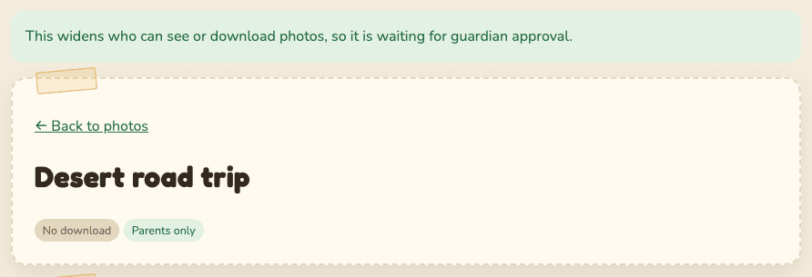
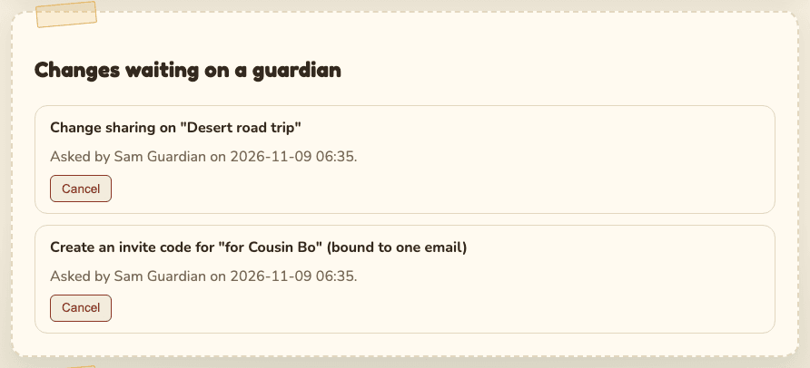
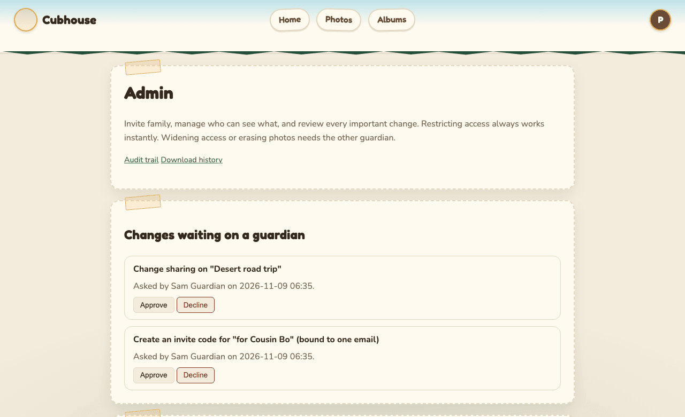
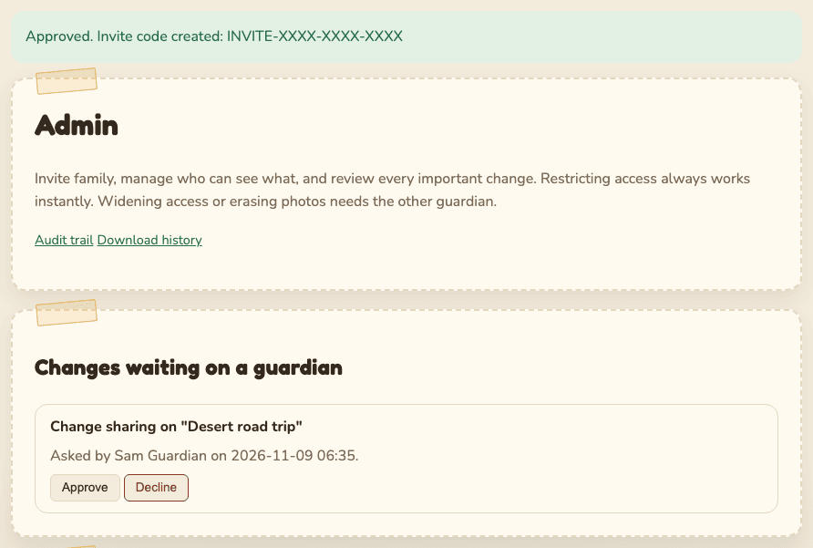

# Two-guardian approval

**Who this is for:** guardians. Family members never see these requests, though they may notice a
photo or an invite takes a little while to arrive.

## Why it exists

Two guardians share control of the child's photos. Some changes are big enough that one person
should not make them alone: sharing photos more widely, letting new people in, or deleting
everything. This protects the child if a guardian's account is stolen, or if the guardians ever
disagree.

The rule is simple:

- **Making things more private is always instant.** Either guardian can do it alone, any time.
- **Making things less private, or destroying photos, needs the other guardian.**

## Which actions need the other guardian

| Action | Where |
| --- | --- |
| Create an invite code | Admin, Invite a family member |
| Add someone to a group | Admin, Groups |
| Change someone's role (Family member or Parent) | Admin, Members |
| Remove a **guardian** | Admin, Members |
| Restore a removed account | Admin, Members |
| Share a photo with the whole family | Photo page, Home approvals, upload profiles |
| Share a photo with more than half of the family, by name or by groups | Photo page, upload profiles |
| Allow downloads of a photo | Photo page, Photos quick actions, bulk toolbar |
| Show a hidden photo again, when that makes it visible to the whole family | Photos quick actions |
| Delete several photos at once | Photos, bulk toolbar |
| Erase the whole archive | Admin, The archive |

These happen **instantly**, by either guardian alone:

- Hide a photo, narrow who can see it, lock downloads, turn the visible mark back on.
- Remove and revoke a **family member**, mute someone, take someone out of a group, delete a group.
- Revoke an invite code.
- Delete **one** photo (you confirm first, and the other guardian gets an email).
- Export the archive (you confirm first, and the other guardian gets an email).
- Issue a sign-in reset code ([with a delay for guardians](account-recovery.md#a-guardian-lost-their-phone)).
- Reject a photo a family member sent in.
- Decline any request.

## How a request works

### 1. One guardian asks

You make the change as usual, for example select **Request invite code**. Instead of happening
straight away, you see a message like:

The request shows in **Admin**, under **Changes waiting on a guardian**. On your own requests the
only button is **Cancel**:

### 2. The other guardian is told

The other guardian gets an email with the subject "A change needs your approval". It says:
"Another guardian asked to: (what you asked). Sign in to approve or decline it." Their **Home**
page also shows **Waiting on a guardian** with a **Review requests** button.

### 3. The other guardian decides

1. Open **Admin** (or select **Review requests** on Home).
2. Read the request under **Changes waiting on a guardian**. It says what, who asked, and when.
3. Select **Approve** or **Decline**.

**Approve** asks you to [confirm it is you](getting-started.md#confirm-it-is-you) first, then runs
the change at once. For an invite code, the new code appears in the message and in the **Invite
codes** table:

**Decline** cancels it. Nothing changes.

### Rules

- Nobody can approve their own request, ever.
- A request expires after **7 days** if nobody decides.
- Every request, approval, decline and expiry is recorded in the [audit trail](guardians.md#the-audit-trail).
- The guardian who asked is **not** emailed when the other approves or declines. Check
  **Changes waiting on a guardian**: when the request is gone, it was decided. The audit trail
  shows which way (`governance.executed` or `governance.declined`).

## If there is only one guardian

With a single guardian there is nobody to approve. So on the family's real site these changes
wait **24 hours** before they happen, and you get an email ("A protected change is scheduled").
The request shows "Takes effect after (date and time) unless cancelled." Select **Cancel** if you
change your mind, or if you did not ask for it.

This gives you a day to notice if someone else got into your account. We strongly recommend adding
a second guardian: invite them as a family member, then change their role to **Parent**.

Once a second guardian exists, waiting requests no longer run by themselves. The second guardian
must approve them.

## Removing a guardian

Removing a guardian always needs the other guardian. The removed guardian is emailed at their own
address. The last guardian can never be removed. This stops one guardian from quietly locking the
other out and then approving their own requests.
